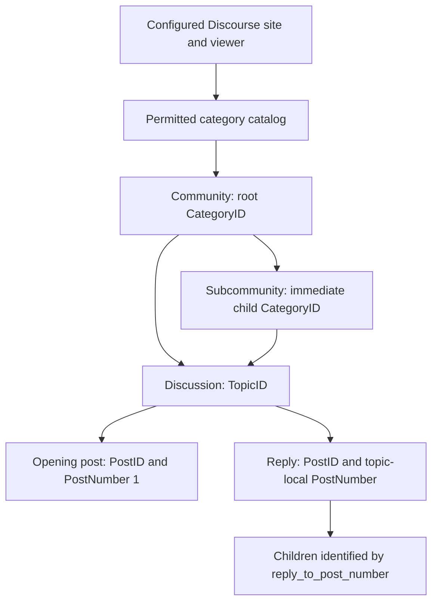
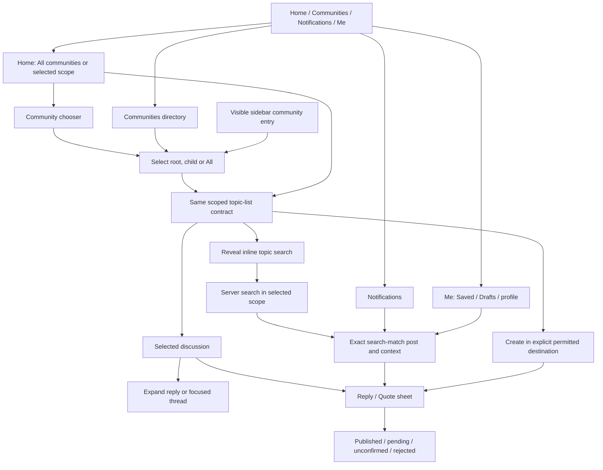
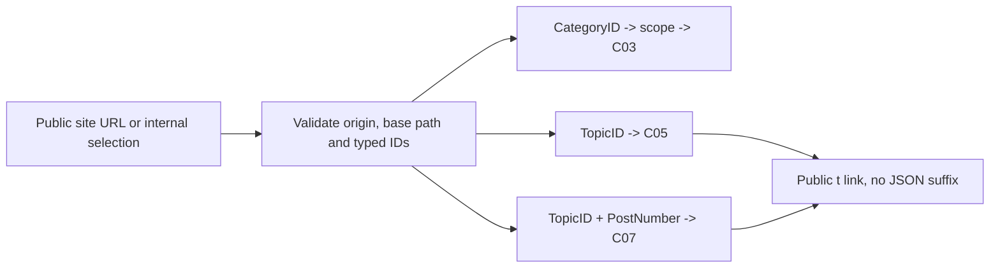

# Adaptive browsing: IA and API connection map

> **Native implementation is now in progress under the later implementation goal.** See the [native implementation and evidence packet](validation/2026-10-20-adaptive-native/README.md) for current source behavior and actual test results. The pre-implementation gap inventories and “no app code changed” statements below refer to their original review/deployment passes; they do not describe the later native work. Final native/five-layout acceptance is still open.

Recorded 2026-10-20 (Asia/Amman). **Pre-implementation contract and review map.** This document connects the adaptive reading mockup to inspected native code and local Discourse source. It does not implement the new shell or authorize backend changes. Specific deployed search verification is recorded below; it does not certify all endpoints or roles.

Design reference: [Fomio Adaptive Reading](https://claude.ai/design/p/16bf8d13-06dd-4c18-a74b-59ebee5a0b6b?file=Fomio+Adaptive+Reading.dc.html). The cloud mockup is editable; this document records the intended behavior, not an immutable source export. Fictional community IDs, counts, excerpts and local search results in that mockup are not API evidence.

Read with [architecture](architecture.md), [category/topic IA](category-topic-ia.md), [API evidence](discourse-api-reference.md), [flows and recovery](flows-and-recovery.md), [notifications IA](notifications-ia.md), and [Duo readiness](iphone-duo-readiness.md).

## 1. Authority and verification ledger

| Label | Meaning in this map |
| --- | --- |
| Design | User-requested mockup behavior; native implementation pending |
| Native inspected | Present in the current working-tree source, including pre-existing uncommitted edits; not a test result |
| Source reviewed | Routes, implementation, JSON/serialization, authorization and relevant specs inspected in the local backend |
| Isolated request tests | 14 member/category/PM examples and a later 42 operator/error/settings/fault examples passed against fabricated users in a disposable source copy; not deployed member acceptance |
| Guest verified 2026-10-20 | Recorded public reads for specific cases; no member/deployment-wide acceptance |
| Historical live | Dated evidence from the existing validation record; not rerun for this map |
| Pending | Requires implementation, request tests, deployed verification or product resolution |

Backend reference: `/Volumes/Develop/Projects/Dicourse`, base HEAD freshly checked at `d4296c5ecf2bef4f11e42d8f3fd2282c8752f4e2`, **plus the authorized uncommitted four-file database-search error fix** ([patch, hashes and verification](validation/2026-10-20-search-database-error-fix/README.md)). The unrelated untracked `docs/sidebar-outlet-discovery.md` was preserved. Initial source/guest reviews made no backend edits; the later user-authorized fix changes only the search rescue, translation and regression specs. No iOS app code or site settings changed. The later authorized deployment modifies two runtime source files and the launcher rebuild hook; normal read probes may produce search logs. The app checkout's pre-existing unrelated edits remain. Earlier guest/member batches and isolated source tests are dated evidence, not deployment of this patch.

The [2026-10-06 live record](validation/2026-10-06-live-api/README.md) documents guest/member reads and an approved temporary posting round trip on the then-configured site. It does **not** validate the new scoped-search request, adaptive shell, all user permissions, fresh sign-in, uploads or current deployed revision/settings. All paths below are relative to the app's configured base URL, including any subdirectory. No new deployment URL, plugin list or credential is supplied here.

**Scoped-search follow-up:** [verification packet](validation/2026-10-20-scoped-search/README.md) and [sanitized request evidence](validation/2026-10-20-scoped-search/guest-results.json). Context-only search is not an immutable scope boundary: a missing context ID returns global results, and `topic:ID` can replace category context. The corrected contract below adds a trusted numeric category constraint, constrained query grammar and response validation. These guards are proposals for native implementation. The [member permission follow-up](validation/2026-10-20-scoped-search/member-permissions.md) adds 14 passing isolated member/category/PM request tests, deployed staff access and guest denial, and positive public pagination. Live non-staff verification remains blocked: the user confirmed only an administrator account is available.

**Operator/error follow-up:** [verification packet](validation/2026-10-20-scoped-search/operators-and-errors.md) records 42 passing isolated examples and 5 guest reads. It adds C17 client settings, validation before generated scope tokens, verified operator/error behavior, and the pre-fix server limitation: a rescued database-search exception could look like a successful empty result. App code is unchanged.

**Database error fix:** [backend validation packet](validation/2026-10-20-search-database-error-fix/README.md) records the authorized local correction, **359 passing examples**, required lint, and real PostgreSQL faults on both JSON endpoints. A caught grouped-query failure now returns a fresh empty result with localized `grouped_search_result.error`; normal zero matches retain no error. **Deployed:** actual container `821e9e2f9f94483a3be8d1e077cde0fd94970479` plus the recorded two-file patch; 305 aligned search examples/lint passed, both isolated deployed-process failure paths passed, and public normal/empty/scoped/validation reads passed after activation. [Deployment identity, persistence limits and rollback](validation/2026-10-20-search-error-deployment/README.md).

## 2. Product model and identities



- All communities is a client scope value, **not category ID 0** and not a Discourse category.
- A root selection includes the root and its visible children. A child is still a CategoryID. Product taxonomy supports root → immediate child; unexpected deeper deployed ancestry needs review, not silent flattening.
- Topic ID, post database ID, post number, bookmark ID, notification ID and draft UUID are distinct. Never substitute one for another.
- Scope uses stable IDs, never translated names, array indexes or the mockup's labels. Names, identity marks and parent links come from the secured catalog.
- Restricted-category regular discussions are distinct from private messages. Authorized read-only category members can search discussions even when they cannot post. All and scoped discussion search must preserve that access while preventing a switch into PM mode.
- Server visibility and posting permissions remain authoritative. `read_restricted` on a returned category is not proof the viewer is denied access.

## 3. Screen and navigation map



### Surface inventory

| ID | Surface | Canonical state and outbound connections |
| --- | --- | --- |
| IA01 | Home/topic list | `scope = all | category(CategoryID)`, feed key, list anchor, selected discussion; C02/C03, chooser IA02, search IA04, discussion IA05 |
| IA02 | Community chooser | One temporary chooser query; secured catalog; All, roots and immediate children; check current ID; commit scope or Cancel; C01, local filtering |
| IA03 | Communities directory / sidebar | Same CategoryID selection contract as chooser; directory query/expansion separate from topic search; C01 → IA01 |
| IA04 | Inline topic search | Validated terms/phrases + selected scope + paging; C17 settings → C04; hit routes preserve exact post number to IA05 |
| IA05 | Discussion/detail | TopicID, optional exact PostNumber, effective sort, expanded branches, reading anchor; C05–C07; actions C09–C13 |
| IA06 | Composer | Draft UUID/account, intent, explicit category or topic/parent post number, raw source and photos; C12/C13; current recovery contract applies |
| IA07 | Notifications | Separate native inbox and typed target contract; C14; see notifications IA for grouped replies/read behavior |
| IA08 | Me/Saved/Drafts/profile | Existing supporting routes; C15/C16; local DraftStore; no new settings or messaging scope |

Search reveal, selector opening, choosing text size, RTL, theme, list visibility and window resizing are presentation events. They must not publish content or acknowledge notifications. A category change may fetch a feed; opening its chooser alone should not refetch a complete fresh catalog.

### Adaptive presentation, one navigation model

| Review preset | Standard intent | When text/window space is insufficient |
| --- | --- | --- |
| Phone | One pane, normal Back | Retain topic/scope/query/draft; reflow controls |
| Duo folded | One pane, system-style vertical rail | Overflow actions remain reachable |
| Duo open | Topic list + selected discussion | Collapse to one pane with the same selection |
| iPad narrow | One pane with adaptive navigation | Reveal hierarchy without permanent cramped columns |
| iPad wide | Optional sidebar + topic list + discussion | Hide optional sidebar first, then collapse list/detail if needed |

Mockup dimensions and thresholds are review proposals, not certified native breakpoints. Never key domain navigation to device name, orientation or hinge angle. The community selector replaces chips on every layout. Topic search starts collapsed on every searchable topic list, reveals by pull or magnifier, stays visible while focused/nonempty, and returns to the previous feed/anchor on Cancel. No search is invented on illustrative or non-searchable destinations.

## 4. Action → request → destination matrix

All GETs are permission-sensitive, even when guest reads are allowed. Existing user credentials accompany reads when available; member mutations require per-user authentication. `page` origins differ by endpoint.

| Contract | Trigger | Method and relative path | Inputs / output used | Status |
| --- | --- | --- | --- | --- |
| C01 | Load catalog for chooser/directory/sidebar | `GET /categories.json` | `include_subcategories=true&page=1…`; optional `parent_category_id=ID` for child completion. `category_list.categories`, recursive `subcategory_list`, parent/identity/permission fields | Source/native reviewed; current guest catalog and child completion checked (11 roots, 9 children). Deployed non-staff/settings matrix pending; 14 isolated permission tests are recorded |
| C02 | All communities, initial/load more | `GET /latest.json` | `page=0…`; `topic_list.topics`, `users`, `more_topics_url` | Source/native/historical live |
| C03 | Root/child selection, load more | `GET /c/{categoryID}/l/latest.json` | `page=0…`; same topic-list envelope; root aggregation includes descendants | Source/native reviewed; guest root/child reads checked; preserve same-origin canonical redirects |
| C04 | Submit/debounce nonempty topic query | `GET /search.json` | `q=VALIDATED_QUERY&page=1…10`; validate original input using C17 before adding scope tokens; category scope adds trusted `category:ID` within q and `context=category&context_id=ID`. Map `posts` to `topics` by `topic_id`; retain post `id`, `post_number`, `blurb`, author and grouped continuation/error | Source and selected guest cases verified, including scope failures. 14 isolated permission examples passed; positive public continuation observed. 42 additional operator/error/settings/fault cases passed; backend error fix passes 359-example local matrix/real-PG checks plus 305 deployed-base examples, isolated deployed-process failures and public smoke checks; native typed scope/grammar/response guards implemented with sanitized tests; final native UI and deployed non-staff acceptance pending |
| C05 | Open topic, root paging | `GET /n/{slug}/{topicID}.json` | `sort=new&page=0…`; `topic`, `op_post`, `roots`, `has_more_roots`, `effective_sort`; later pages may omit metadata | Source/native/historical live; deployed nesting capability must be established |
| C06 | Expand/load more replies | `GET /n/{slug}/{topicID}/children/{parentPostNumber}.json` | `sort=new&page=0…&depth=DEPTH`; `children`, `has_more`; retain parent identity and per-branch errors | Source/native/historical live |
| C07 | Exact post / focused branch | `GET /n/{slug}/{topicID}/context/{postNumber}.json` | `sort=new`; focused route adds `context=0`; topic/OP, `ancestor_chain`, `target_post`, truncation and effective sort | Source/native/historical live; never use PostID in post-number slot |
| C08 | Resolve missing category / About metadata | `GET /c/{categoryID}/show.json` | Category object, identity, ancestry and `topic_url` where returned; About follows verified same-site source link | Source/controller/serializer/authorization/request specs reviewed; native fallback and identity/member-header/permission tests implemented. No new deployed fallback-role acceptance |
| C09 | Like/unlike a post | `POST /post_actions.json` / `DELETE /post_actions/{postID}.json` | `id=postID`, `post_action_type_id=2`; returned post state | Existing adapter; source evidence in API reference; this map adds no mutation test |
| C10 | Save a specific post | `POST /bookmarks.json` | `bookmarkable_type=Post`, `bookmarkable_id=postID`; returned bookmark `id` | Existing adapter; historical live Save/Unsave |
| C11 | Unsave | `DELETE /bookmarks/{bookmarkID}.json` | Exact returned bookmark ID, not topic/post ID | Existing adapter; historical live; no bulk topic-bookmark deletion |
| C12 | Explicit Post in composer | `POST /posts.json` | New topic: `title`, `raw`, `category`; reply: `topic_id`, `raw`, optional `reply_to_post_number`; existing adapter sends `nested_post=true`. Confirmed post identity vs enqueued/uncertain outcomes | Existing adapter/source evidence; historical temporary posting. New shell must preserve recovery |
| C13 | Upload selected photo | `POST /uploads.json` | Multipart `upload_type=composer`, `file`; `short_url`, URL and dimensions | Existing adapter; live upload pending; upload is not publication |
| C14 | Inbox and exact read action | `GET /notifications.json`; `PUT /notifications/mark-read.json` | Existing adapter uses offset/limit/type filters; write requires exact notice `id` | Detailed source and delivery gates in notifications IA; no new write verification |
| C15 | Profile / recent topics / Saved | `GET /u/{username}.json`, `/topics/created-by/{username}.json`, `/u/{username}/bookmarks.json` | Existing typed profile, topic and saved target mapping; Saved `page=0…` | Existing adapter and dated member read evidence; no new acceptance claim |
| C16 | Draft list / Keep / Resume / Discard | Local DraftStore, **no server endpoint** | Account-scoped UUID, raw body/title/destination, attachments and submission lock | Native inspected; mockup local state is not durable storage evidence |
| C17 | Resolve search validation settings | `GET /site/settings.json` | Client settings object: positive integer `min_search_term_length`, `default_locale`; no client-exposed `allow_anonymous_search` flag. Normal login-required permissions apply | Source + 3 isolated request tests + guest deployed read (3/en). Native settings/original-term validation implemented and sanitized tests pass; deployment values remain site/viewer dependent |

Secondary action rows C09–C15 connect to existing contracts; their full auth/controller/spec traces remain in the API reference and notifications IA. This task freshly traced C01–C08 rather than repeating all prior write audits. Report/block/account deletion retain existing safety routes and are outside this adaptive browsing change.

## 5. Search and category contract details

### Catalog and chooser search

Chooser “Find communities” filters the loaded, permission-filtered catalog locally by name and optional available description. Keep the parent visible when a child matches. It does not call topic search and must not treat a partial directory as exhaustive. On an incomplete load, show loading/retry or “Search loaded communities”; do not claim the community does not exist.

The current adapter pages roots from 1, deduplicates IDs, checks embedded child previews against IDs/counts and fetches missing immediate children using `parent_category_id`. A no-progress page ends a sequence; a 100-page cap produces an error instead of false completeness. Category JSON has no universal next-page token. This existing heuristic still needs the deployed lazy-catalog/permission matrix. Do not copy fictional topic counts into production; hide unverified counts rather than counting only currently loaded feed rows.

### Scoped topic search: proposed wire contract

Use a typed client scope (`all` or a positive catalog CategoryID), with required validation before sending a request:

```text
All scope:
GET {configuredBase}/search.json?q={encodedValidatedUserQuery}&page=1

Category scope:
GET {configuredBase}/search.json?q={encodedValidatedQueryPlusCategoryConstraint}&page=1&context=category&context_id={CategoryID}

Logical scoped q example: Fomio category:45
```

First resolve C17 and validate trimmed meaningful user terms/phrase contents, including balanced phrase delimiters, before adding generated operators. Empty user input restores the feed; short input shows guidance without a search request. The server minimum is bypassed by `category:ID`: guest `xy` returned 400 while `xy category:45` returned 11 category hits. A character-count check on the final encoded/composed q is insufficient.

Construct the logical query first, append a standalone trusted numeric `category:ID` token, then encode it once with URLQueryItem. Keep the original user input separate. Never derive scope from a translated label or silently fall back to All when a scoped ID is missing.

`SearchController#lookup_search_context` resolves the category and checks visibility. Category context restricts posts to that category and immediate children, but `Search#process_advanced_search!` runs after context initialization: a permitted `topic:ID` can replace it. The guest probe reproduced this with a hit outside the selected category. Missing `context_id` also returned global results. These are scope correctness failures, not evidence of a permission bypass; Guardian still applies.

Numeric `category:ID` is an additional intersecting filter and includes descendants; `=ID` means exact category only. The generated numeric constraint prevented the reproduced topic override and preserved the normal root results. The operator follow-up adds verified uppercase/quoted category filters, category unions/exact forms, topic overrides, all-posts cardinality, nested context precedence and skip_context behavior. These finite cases are not proof against all grammar/plugins. The proposed first native grammar exposes ordinary terms and balanced phrases. Reject advanced operators/shorthand outside that grammar visibly, preserving input; this includes: topic selectors, private-message selectors, `in:all`/PM modes and user category constraints. Use parser-aware validation, including quoted forms; quoting is not general escaping and behavior varies by operator. Reserved shorthand/colon text and any future narrowing features need explicit grammar tests; a short denylist is not complete. Apply the discussion-only mode policy to All as well. Build only q/page/context/context_id; never forward skip_context or nested context/unknown fields from incoming URLs. Nested context overrides top-level context, and skip_context=true bypasses it. The internal `exclude_private_messages` search option is **not forwarded by this HTTP show action**; do not invent a request parameter.

Validate each result against the active request generation and scope, positive post identity/number, joined topic metadata and public discussion archetype. A mismatch is a contract error, not silent filtering into “no results.” An unexpected deeper catalog needs parity review: category context includes immediate children, while numeric category filters and feeds can traverse descendants. Root feed and search need the same allowed category boundary, not equal result sets or counts.

`/search.json` maps to full-page `show`, defaults to topic search and does not forward `type_filter` like `/search/query`. The native adapter's `type_filter=topic` does not establish an immutable public-topic mode. Pages start at 1, normalize to at least 1, and source rejects pages above 10 (guest page 11 returned 400). Fetch the minimum through C17; this guest site reports 3/en, while the native UI currently accepts 2. Three is not a universal minimum, and generated operators bypass that server check. Handle HTTP failures and optional/null `grouped_search_result.error`; a 200 with an error is not valid empty results. Process grouped errors before hit/cache mapping. The deployed patch signals caught grouped-query database errors through the same field and discards partial results; its release identity and verification limits are recorded above. Empty `posts` can accompany omitted `topics`. Retain server continuation. The original Fomio query had an empty page 2; a follow-up public `source category:4` query returned 50 hits on each of pages 1 and 2 with continuation true and no exact-hit overlap. This closes positive public continuation for that sample, not exhaustive or authenticated paging.

Default search aggregates to one matched post per topic, ordinarily the lowest matching post number; ordering and modes can change selection/grouping. Topic context or `in:all-posts` can produce multiple hits per topic. Preserve exact PostID and `(TopicID, PostNumber)` identities regardless. The current DTO drops PostID and grouped errors; its topic-summary model needs revision before migration.

Search GETs can record search logs and trigger `:user_search` events. No direct background job or realtime publication was found in the inspected path; plugin event handlers are unknown. These reads do not publish discussion content.

### Search failure and recovery rules

[Full error/operator matrix and evidence](validation/2026-10-20-scoped-search/operators-and-errors.md).

| Outcome | Connection rule |
| --- | --- |
| 400 validation | Preserve scope/input; show actionable validation. Builder emits canonical integer pages 1–10 even though server normalizes 0/-1. Never broaden scope or loop retries |
| 403 not_logged_in | Offer sign-in and retain search intent |
| 403 invalid_access | Can mean denied category **or expired/revoked key**. For member requests, check the existing authenticated session contract before classifying. No automatic guest fallback or credential deletion on every 403 |
| 429 | Respect valid Retry-After when present; search-specific limiter can omit it. Retain state and use bounded backoff/manual retry |
| 200 grouped error | Search failure, not no matches; check before publishing cache/results. Covers overload and, on the verified patched deployed release, caught grouped-query database errors |
| 200 invalid envelope/identity/join/scope | Explicit contract failure; do not drop bad hits into an apparent empty state |
| Valid empty envelope | Normal no matches has no grouped error. The deployed caught-query rescue is verified separately from normal empty results; other unhandled failures still require explicit handling |
| Offline/cancel/stale/5xx | Distinct lifecycle states; ignore obsolete results **and errors**, cancel quietly, preserve only permitted same-key data; native tests pending |
| More results at page 10 | Stop and offer query refinement; no request for page 11 or exhaustive-results claim |

**Fixed and deployed:** the original `Search#find_grouped_results` rescue erased `ActiveRecord::StatementInvalid`, producing 200 + empty/partial results without a signal. The authorized patch logs the exception server-side, creates a clean `GroupedSearchResults` retaining type/term/context, and sets localized `search.query_error`. `Search#execute` returns before preload/success-event processing. Both JSON endpoints returned explicit grouped errors under real isolated PostgreSQL faults, without database details; normal zero matches stayed error-free. The 359-example final matrix/lint pass on the recorded patch. The later [deployment packet](validation/2026-10-20-search-error-deployment/README.md) confirms the fix on the actual newer deployed base, isolated process failure envelopes and public HTTPS smoke checks. This closes the inspected rescue/deployment gap for this release, not every exception, native handling or member-role acceptance. See the [patch and verification](validation/2026-10-20-search-database-error-fix/README.md).

### Native grouped-search error contract

Defined 2026-10-20; refined in this documentation-only review. **No app, mockup or backend code changed, and no native tests ran in this review.** Backend failure-envelope verification is established for the recorded deployed release. Current native implementation evidence is tracked separately in the [native packet](validation/2026-10-20-adaptive-native/README.md); this specification does not certify that implementation. This contract applies to C04 on every searchable topic list in all five layouts. `/search/query.json` has the same grouped-error rule if adopted later; this does not add it to the native request plan.

**Historical native gaps at the original definition:** `SearchDTO.Group` in `DiscourseService.swift` decodes only continuation. `DiscourseService.search` immediately joins hits, silently drops missing topic joins with `compactMap`, then writes `metadata`/`topicSlugs`. `SearchView` has one local string error; Retry always requests page 1. Successful completions check only query/cancellation, while catch and `defer` can publish stale error/loading state. Query changes leave earlier rows visible, and an older `searchCompletedQuery` can suppress a later retry. `TabState` lacks typed search scope, request identity and operation-specific failure state. `APIClient` accepts every 2xx body and has no search-specific HTTP cache policy. These are source observations, not reproduced native test failures. Source locations: `Fomio/Data/DiscourseService.swift` (`search`, `SearchDTO`), `Fomio/Data/Network.swift` (`request`, `get`), `Fomio/Features/AccountViews.swift` (`SearchView`), `Fomio/App/AppState.swift` (`TabState`), and `Fomio/Domain/Models.swift` (`RepositoryError`).

**Documentation review, 2026-10-20:** this pass refines the native contract only. The workspace already contains in-progress `DiscussionSearchRequest`, `DiscussionSearchState`, a preliminary grouped-error decoder and search cache controls. Those pre-existing changes are preserved; the historical gap inventory above describes the baseline at the original definition, not the current contents of those files. Their presence is not acceptance evidence. No app, test, project, mockup or backend source is changed or tested by this review. Backend reference HEAD was rechecked at `d4296c5ecf2bef4f11e42d8f3fd2282c8752f4e2`; deployed behavior relies on the dated release packet above.

#### Adapter boundary and result publication

1. Preserve HTTP classification first: 400 validation, 401/ambiguous 403 session/permission, 409 rejection, 429 throttling and 5xx remain distinct from HTTP 200 grouped errors. The backend can return overload as a grouped error in `show`, or HTTP 409 through its overload callback. Neither path establishes a machine-readable overload code.
2. For a JSON success body, inspect the grouped-error field before decoding/mapping hit content. A string trimmed of whitespace/newlines that is nonempty is a typed **server-search failure**. Missing/null/empty/whitespace-only error means only “no explicit grouped error”; continue envelope validation. A non-string non-null error, malformed group, invalid JSON or invalid envelope is a **contract failure**. A preliminary error-envelope decode must not depend on successful decoding of partial posts/topics: a genuine grouped error wins even if those unused facets are malformed.
3. Reject the entire failed response, including any hits, continuation, topic metadata or slugs it contains. Do not return `Page(items: [], nextPage: nil)`, update completed-success state, or insert an empty-success cache entry. The adapter throws a typed search failure, distinct from invalid user input, offline, permission and transport failure. Exact Swift case names are implementation choices; the semantic distinction is required.
4. A no-error response must pass the C04 envelope, identity, join, discussion-mode and scope checks in full before **any** cache write. Empty posts with absent topics is valid; a documented stop-word empty shape must also remain supported. Missing fields alone and `{}` are not proof of zero matches. Unexpected/malformed envelopes and missing joins fail visibly rather than losing hits through `compactMap`. Add sanitized fixtures for each supported empty shape before implementation is accepted; do not enforce a new required field solely from a populated sample.
5. Publish validated items, continuation, metadata and successful key atomically. Only a validated current page-1 empty result may display “No results”; a later empty page means no additional hits. Failure never advances the successful page boundary or proves exhaustion. Retain exact PostID and `(TopicID, PostNumber)` identity under the existing search-hit contract.

Do not compare English or translated server messages to identify database failure versus overload: the field carries human text, not a stable error code. Present native localized fallback copy for every grouped failure: **“Search unavailable” / “Search couldn’t be completed. Try again.” / “Retry.”** Do not render server text as HTML, links or an instruction, and do not expose database/transport diagnostics. An optional future machine-readable server code needs its own verified contract. No such backend extension is required for this handling.

#### Response decision order

Apply this order before admitting a response to any result or metadata cache. These examples define decisions; they are not new deployed probes or test results.

| Response | Native decision | May establish “No results”? |
| --- | --- | --- |
| Request cancelled or attempt superseded | Ignore; publish no error, rows or loading cleanup for another attempt | No |
| Non-2xx HTTP status | Keep the status-specific validation, session/permission, throttle or transport recovery above; do not reinterpret its body as successful search | No |
| 2xx, valid error envelope with nonblank `grouped_search_result.error` | Server-search failure, even if posts/topics are populated or malformed; discard all response data | No |
| 2xx, error is a number/object/array/boolean, invalid JSON or invalid group | Contract failure; discard all response data | No |
| 2xx, error absent/null/blank | Continue full envelope/identity/join/scope validation; absence of error alone is not success | No, until validation finishes |
| Fully validated current page 1, zero hits | Commit successful empty snapshot and continuation according to the supported envelope | Yes |
| Fully validated current page N, zero additional hits | Preserve committed earlier rows; finish paging according to validated continuation | No; this is not an empty initial search |

For example, `{"grouped_search_result":{"error":"Search could not be completed. Please try again."}}` selects the failure branch before hit decoding. It is an illustrative error discriminator, not a complete success schema. Replacing that string with localized or unknown nonblank text must produce the same native decision. Replacing it with `null` does **not** make this minimal object a valid empty result. A full supported no-error envelope is still required.

#### Reviewable recovery scenarios

1. **First search fails:** retain the displayed query and community; end loading; show “Search unavailable” and Retry in the list. No “No results” card appears. Retry requests page 1 once.
2. **Refresh fails after two successful pages:** retain those permitted rows and their position, label “Showing previous results,” and suspend More. Retry requests page 1. A successful refresh replaces both old pages; a validated empty replacement may then show “No results.”
3. **Page 2 fails:** retain page 1 and its position; show “More results couldn’t be loaded” with footer Retry. Retry requests page 2, appending only validated hits once. Neither failure nor retry advances to page 3.
4. **Community changes before failure arrives:** invalidate the old attempt. Its error, cached metadata and cleanup cannot affect the new community's search. Retry always belongs to the current query/scope, never the previous selection.
5. **Permission fails instead:** use the separate session/visibility recovery and remove affected private snapshots. A generic grouped failure by itself does not sign out the person or clear an otherwise permitted discussion/draft.

Each scenario must be exercised against controlled transport completions and then its applicable native presentation. Preserve these expected outcomes when reviewing evidence; a working initial Retry does not establish refresh or pagination recovery.

#### State, retention and retry

Search state belongs to the originating tab's search owner, surviving pane moves and temporary view removal. Use an explicit phase, successful snapshot and optional failed operation rather than inferring success from empty rows or an old completed-query string. The active identity includes site/base path, account, viewer/permission revision, typed scope, trimmed original query (no case folding), effective response locale, and request generation. Each attempt also captures operation, requested page and a unique attempt ID. These extend the proposed `SearchKey` below; generated scope tokens are not the user's displayed query.

| Failure during | Visible state | Retained data and Retry target |
| --- | --- | --- |
| Initial page 1, no successful snapshot for this key | Inline error in the results area; no empty-results card | Keep query/scope; Retry page 1 for the captured key |
| Page-1 refresh of a successful identical key | Inline refresh failure above retained permitted rows, labeled “Showing previous results” | Keep snapshot/anchor; suspend its More action. Retry page 1; success replaces the complete old sequence and its continuation. A prior empty snapshot does not show a no-results card while refresh has failed |
| Load-more page N | Footer “More results couldn’t be loaded” and Retry; earlier rows remain usable | Keep successful pages, anchor and failed page N. Retry N once per tap; do not reset to page 1, append failed-response hits, advance N, or infer end of results |
| Query, scope, locale, site or viewer identity changed | New key's loading/error/content state | Earlier key's rows/error/continuation cannot appear under the new query/scope. Retain only an explicitly keyed permitted in-memory snapshot; no cross-account fallback |
| Permission revoked or session invalidated | Existing authorization recovery, with affected content removed | Grouped errors do not imply denial. Explicit auth/visibility failure invalidates affected snapshots and attempts; never keep private rows usable as a recovery cache |

Retry is manual for grouped and contract failures; no timer, reconnect, foreground, view reappearance or layout change retries them automatically. Use one in-flight operation per active key; coalesce/disable repeated Retry and submit/debounce duplicates. Preserve failed-page context until success, input change or Cancel. Retry starts a new attempt/generation and rechecks current key, input validation and permission context; it cannot send an old scope after the user has changed selection. If a known HTTP 429 cooldown applies, Retry respects it under the separate throttling contract; grouped messages imply no countdown or Retry-After. Offline and authentication recovery keep their existing distinct actions.

Apply the current key/generation/attempt guard to **success, failure, cancellation and loading cleanup**. Cancellation is silent; handle both task cancellation and a cancelled URL request without an offline error. A late failure cannot cover newer results; an old `defer` cannot stop a newer spinner. Guard same-query retries too: matching text alone is insufficient. Only successful validation updates the last-success key; a failed refresh must remain retryable even when that key already has a successful snapshot. Clear input or Cancel invalidates attempts/errors and restores the scoped feed/anchor; it sends no search request and changes no draft or selected-detail permission.

#### Event transitions and failure ownership

The implementation must make these decisions explicitly. `current` means the full active key plus attempt identity matches; checking only the query text or page is insufficient. Evaluate this guard before publishing any completion, including errors and loading cleanup.

| Event | Required transition | Network/cache effect |
| --- | --- | --- |
| Reveal search, move/fold a pane, change appearance | Preserve the current phase, failed operation, query and selection | No request; no cache publication |
| Valid new query/scope/locale/viewer | Invalidate previous attempt; clear its visible rows/error; start initial page 1 after normal debounce/validation | Never reuse a different key's snapshot; account/permission invalidation also removes affected cached content |
| Current grouped/contract failure | End that attempt's loading; record the captured operation and failure kind; show initial, refresh or footer presentation as specified above | No hit/metadata/continuation/success-key writes; no automatic retry |
| Manual Retry | Revalidate current identity and input; consume the captured initial/refresh/more operation into one new attempt | Request that operation's page; disable/coalesce duplicate taps; obey any separate HTTP cooldown |
| Current successful Retry | Initial/refresh replaces the whole sequence; more appends the validated requested page; clear its failure | Publish only after full validation; retain exact-post identity; do not duplicate an already committed page |
| Late success/error/cancellation/cleanup | Ignore it completely | Cannot replace rows, clear a newer spinner, announce a failure or mutate shared caches |
| Clear input or Cancel | Invalidate attempts; remove search error/results; return to retained scoped feed | No empty-query request; selected detail/draft remains subject to its existing visibility rules |
| Explicit authorization/visibility failure | Invalidate affected private snapshots; retain non-sensitive query intent for recovery | Session-aware classification; no automatic guest retry or scope broadening |

The error owner is the search operation, not the selected discussion or composer. A grouped failure does not revoke a permitted open discussion, dismiss its editor, alter a draft destination or show a global app error. Conversely, an explicit permission failure must not be disguised as a retryable grouped failure merely to retain private content.

Copy and accessibility are part of the contract: initial/refresh uses “Search unavailable”; pagination uses “More results couldn’t be loaded”; grouped-failure body uses “Search couldn’t be completed. Try again.” A refresh additionally labels its retained snapshot “Showing previous results.” Use native localized strings, semantic alignment and a persistent labeled Retry button. Announce once per newly accepted failed attempt, not per rendering or resize. These are proposed native strings; translated server text is never used as a classification key.

**Acceptance evidence must name its layer.** Backend fault probes establish the envelope; sanitized adapter tests establish decoding/cache admission; controlled state tests establish transitions; native UI/device checks establish presentation and adaptation. Passing one layer cannot close another. Each required case below needs its actual result/artifact before being marked accepted; this documentation pass runs none of them. The existing admin-only account limitation remains a separate live ordinary-member permission gate.

#### Cache and presentation boundaries

- Cache only fully validated successful search snapshots in memory, partitioned by the identity above. Failed responses never replace a previous success, refresh its freshness, or populate shared metadata. Failure state is ephemeral UI state, not a reusable response cache. Revalidate/invalidate on viewer permission changes; no new durable/offline search store is proposed.
- Bypass HTTP response-cache reuse **and prevent storage for native search requests**; rely on the validated domain snapshot for deliberate retained rows. This must cover Retry as well as first loads: Discourse search actions declare a one-minute HTTP expiry, and a 200 failure must not be replayed as cached success. An ephemeral URLSession alone is not the contract. Select a request/session/delegate implementation that enforces both read and write policies, and test it without weakening cache behavior for unrelated endpoints.
- Keep one persistent inline message near the affected results, with an accessible heading and labeled Retry. Keep query, selected community and Cancel available; focus stays where the person is editing or retrying. Announce the new current failure once to VoiceOver without stealing focus or repeating it during re-render. Indicate failure through text as well as color; spinner ends for that attempt.
- Phone, folded Duo and narrow iPad use the same full-width list error/footer. Open Duo and wide iPad put it in the search/list pane, preserving permitted selected discussion and composer. Do not use a transient toast or repeated modal alert. Large text wraps message/actions without truncation; RTL uses semantic reading order/alignment. Resize/theme/text-direction changes preserve the same error, attempt and retry target and make no extra request. Review all five presets with Dynamic Type, VoiceOver, Arabic and dark mode before acceptance.

The inline presentation is a Fomio design decision informed by Apple's [Feedback guidance](https://developer.apple.com/design/human-interface-guidelines/feedback), read in the rendered browser on 2026-10-20: place status near its context and match interruption to importance. Accessibility and RTL here also preserve the mockup's existing requirements; no native HIG compliance or device acceptance is claimed.

#### Required acceptance cases before native handoff

| Layer | Required checks (this review adds no execution evidence) |
| --- | --- |
| Adapter | Both recorded grouped failure envelopes throw typed search failure; arbitrary localized/unknown text behaves identically. Nonempty error plus populated or malformed facets produces no items/metadata writes. Missing/null/blank error proceeds to validation. Wrong error type, invalid group/JSON, `{}`, missing join and scope mismatch fail as contracts; valid populated, zero-match and documented stop-word shapes succeed |
| Paging/cache | Page-2 failure retains page 1 and retries page 2; failed page-1 refresh retains labeled same-key rows and suspends paging; successful refresh replaces old pages, including a valid empty replacement. Cache/metadata remain unchanged on failure. Retry bypasses a previously cacheable HTTP 200 error; search responses are not stored by transport |
| Concurrency | Old error/success/cleanup after query, scope, account or locale change has no effect. Same-key overlapping attempts cannot win out of order. Cancellation is silent, duplicate taps send one request, failure after prior success remains retryable, permission invalidation removes private snapshots |
| UI/adaptation | Initial error, retained-refresh error and footer error have reachable correct Retry targets and no simultaneous no-results state. Successful Retry clears only the relevant error. Query/Cancel/detail/draft/anchors survive all five layouts, large text, RTL, dark mode and VoiceOver; resizing issues no request |

These native tests must use stubbed transport/fixtures and controlled delayed completions. Do not induce a production database failure for UI acceptance. Live ordinary-member permission checks and future-release preservation of the backend patch remain separate gates.

C17 is subject to ordinary site login requirements; `/site/basic-info.json` remains the separate public bootstrap. Store validated minimum/locale with site/viewer context and represent missing settings honestly. Anonymous-search availability is not a client setting in this source; handle the actual search response.

### URL construction and public links



- API requests use configured base URL + relative endpoint and `URLQueryItem`; encode Arabic, `+`, `&`, `#`, spaces and search operators exactly once. Existing `LiveConfiguration.url` explicitly encodes literal `+` to `%2B` to preserve queries such as `C++` and authorization material.
- Share uses the existing public `/t/{TopicID}/{PostNumber}` helper, not `/n/.../context/...json`. Do not include API keys, internal requests or draft identifiers in share links.
- Canonical category redirects can add slugs; accept only same-origin redirects and preserve any configured base path. Do not build category URLs from localized display names.
- Current `LinkRouter` recognizes same-site `/c/.../{id}`, `/t/.../{topicID}[/{postNumber}]`, `/n/.../{topicID}/context/{number}` and basic `/u/{username}` links. Search URLs, arbitrary filters/query fragments, `/children` branch URLs and all notification-specific variants are not comprehensively handled. Do not label universal links or every Discourse URL supported.
- External links use the established external-opening policy; never route another site's category/topic IDs into this site's API. Missing/denied targets must preserve the originating screen's Back context without disclosing private metadata.

## 6. State ownership and request lifecycle

Proposed browse state (not new Swift code):

```text
BrowseContext = site/account + originatingTab + scope(all | CategoryID)
FeedKey       = site/account + scope + explicitLatest
SearchKey     = site/account/viewerRevision + scope + trimmedUserQuery + effectiveLocale
DetailKey     = site/account + TopicID + optional targetPostNumber + focus mode
DraftKey      = account + draftUUID (intent carries destination)
```

Store catalog once per site/viewer revision; never share a restricted member catalog with guest/other-account state. Keep chooser query, directory query and topic query separate. One scope-selection operation is used by header, sidebar and directory; a view must not maintain a competing category filter. Preserve independent tab navigation histories: common category semantics do not mean overwriting all tab paths. Whether directory selection switches to Home as in the mockup or keeps the Communities origin needs an explicit native routing decision before implementation; recommended default is to retain the origin and Back context.

On category/query change: capture prior list anchor; change the active key; cancel obsolete requests; advance a generation token; use cached data for that exact key or load its first page. A late response is applied only when site/account/scope/query/generation still match. Cancellation is not “no results.” Do not filter just the currently loaded Latest page to simulate whole-community search.

Scope changes preserve writing. If the selected discussion belongs to the new scope, retain it. If outside scope, hide its detail behind an explicit selection notice while retaining its permitted cache/anchor; do not mislabel it as part of the new feed. Revalidate permission on refresh or account change; inaccessible content is removed rather than retained as a usable cache. Deep links and published posts are explicit targets: if outside the active scope, switch to a containing scope or show an explicit outside-scope target with a return path, never silently hide the requested destination.

Resize, text size, RTL and theme changes only adapt presentation, never reset identifiers, refetch solely because a pane moved, duplicate a composer, or submit a second write. Draft text and editor ownership stay independent of list visibility. Navigation/scroll state is currently in-memory; only drafts/credentials are durable. No process-restoration guarantee is added by this map.

```mermaid
stateDiagram-v2
  [*] --> Feed
  Feed --> SearchRevealed: Pull at list top or magnifier
  SearchRevealed --> Searching: Nonempty query passes server/client validation
  Searching --> Results: Current request succeeds
  Searching --> SearchError: Offline, denied, rate limit or server search error
  Results --> Searching: Query or scope changes
  Results --> Feed: Cancel restores prior feed key and anchor
  SearchRevealed --> Feed: Empty and unfocused; hide or Cancel
  Results --> Detail: Select exact match
  Detail --> Results: Back to retained results
  SearchError --> Searching: Explicit retry / valid query change
```



Debounce topic queries; reveal/collapse alone sends no request. On clearing to an empty query, restore scoped Latest rather than querying an empty search term. On scope change during search, keep the visible user query, reset paging and issue C04 in the new scope. Keep server ordering and result continuation; Latest is activity order with pin/ranking rules, not an invented creation-time sort.

## 7. Failures and member actions

| Condition | Required behavior |
| --- | --- |
| Catalog loading/partial/error | Chooser explains loading/completeness; retry; never synthesize hidden categories |
| Empty category vs no search matches | Separate messages; category may be valid with zero topics; search failure is neither |
| 401 / invalid session | Retain destination and writing; reauthenticate; recheck permission; never auto-post. Expired/revoked per-user keys can instead return 403 |
| 403 / 404 | Distinguish search permission from invalid member session where possible; unavailable/denied recovery without private-content leaks; nested 404 alone cannot prove feature disabled |
| Offline / refresh failure | Retain previously permitted loaded content and offer retry; account/visibility denial clears it |
| 429 / search overload | Preserve query/scope and show retry guidance; no tight auto-retry loop |
| Missing nested feature | Explicit unsupported/unavailable path based on established capability; never silently replace a threaded discussion with a flat reply interpretation |
| Quote / Reply | Local composer intent references TopicID and parent PostNumber; raw quote/source rules remain in current composer contract |
| Published | Reconcile affected caches and open confirmed TopicID/PostNumber; a new post must not disappear behind a mismatching scope |
| Pending / unconfirmed write | Preserve locked record and distinct outcome; no automatic retry or assumed idempotency; `reconcile` currently returns unresolved |

Do not add `track_visit=true` merely because the detail pane becomes visible. Source nested tracking can mark a topic caught up; visible pane geometry is not proof every post was read. Notification acknowledgement is separate and requires its own exact-ID action contract.

## 8. Evidence trace for freshly reviewed browsing contracts

All backend paths below are relative to `/Volumes/Develop/Projects/Dicourse` at the recorded base HEAD plus the linked search-error patch where applicable. Existing source specs were read; the follow-ups separately ran the linked 14 permission examples and 42 operator/error/settings/fault examples in an isolated copy. The final backend patch passed 359 examples against exact copies of the formatted files, plus real isolated PostgreSQL error probes. No specs ran against the deployed site or reference checkout.

| Contracts | Routes and implementation | JSON/authorization | Spec evidence inspected |
| --- | --- | --- | --- |
| C01/C08 | `config/routes.rb` category resources and `c/:id/show`; `CategoriesController#index/#show/#fetch_category_list`; `CategoryList` | `CategoryListSerializer`, `CategoryDetailedSerializer`, `BasicCategorySerializer`; Guardian-secured catalog and `ensure_can_see!` detail; category permissions independent of global create flag | `spec/requests/categories_controller_spec.rb`: lazy and large catalog pagination, hidden categories, include_subcategories; `spec/models/category_list_spec.rb` located for future execution |
| C02/C03 | Dynamic latest/category routes; `ListController` generated category action, `#set_category`; `TopicQuery#list_latest/#default_results` | `TopicListSerializer` / topic-item serializers; category visibility check and secured topic filtering; canonical slug redirects | `spec/requests/list_controller_spec.rb`: includes subcategories when false exclusion flag, category access and canonical redirects |
| C04 | `search#show`, `SearchController#show/#lookup_search_context`; `lib/search.rb` context initialization, advanced filter replacement/intersection, aggregation and search logging/events | `GroupedSearchResultSerializer`, `SearchPostSerializer`/topic result mapping; search eligibility, context visibility and secure category filters | `spec/requests/search_controller_spec.rb`: 429, malformed/invalid search and lazy category context data; `spec/lib/search_spec.rb`: numeric category matching, exact/descendant filters and category search context. Selected guest category-context, conflicting-operator, missing-ID and numeric-guard cases recorded; 14 isolated permission and 42 operator/error/settings/fault request examples passed; deployed ordinary-member cases remain blocked by account availability |
| C17 | Site namespace settings route; `SiteController#settings`; `SiteSetting.client_settings_json` / `client_settings_hash_uncached`; `config/site_settings.yml` client flag | Client settings object and default locale; normal login-required permissions, no exposed anonymous-search flag | 3 isolated settings request tests; deployed guest minimum/locale read; linked operator/error packet |
| C05–C07 | `/n/:slug/:topic_id`; `NestedTopicsController#show/#children/#context`, feature/PM/visibility gates; `NestedTopic::ListRoots/ListChildren/ShowContext` | `NestedReplies::PostTreeSerializer`, `PostSerializer`, `TopicViewSerializer`; deleted/ignored placeholders and effective sort | `spec/requests/nested_topics_controller_spec.rb`: initial/later roots, children/context, visibility, sort and tracking; historical live context/children in linked record |

Current native evidence: `Fomio/App/AppState.swift` (typed scope, per-tab routing and permission invalidation), `App/FomioApp.swift` (adaptive split projection), `Domain/DiscussionSearch.swift` (request/hit/failure/settings), `Features/DiscussionSearchState.swift` (retained attempts/recovery), `Features/CommunityScopePicker.swift` (secured chooser), `Data/DiscourseService.swift` and `Data/Network.swift` (adapters/cache/link boundaries), `Features/FeedView.swift` (shared list/search/header), and `FomioTests/AdaptiveSearchTests.swift` plus native UI suites. `AccountViews.swift` retains exact search-result rows; the separate SearchView was removed.

## 9. Implementation gaps and acceptance gates

The later authorized implementation supersedes the original missing-code inventory. This table records current state without treating code presence as final acceptance; see the [native evidence packet](validation/2026-10-20-adaptive-native/README.md).

| Area | Current implementation/evidence | Remaining acceptance |
| --- | --- | --- |
| Adaptive shell | Typed scope and canonical per-tab selection, NavigationSplitView projection, optional community sidebar and compact Back; actual phone rotation/composer retention passed | Actual Duo fold/Back and iPad sidebar/outside-scope/chooser Zoom have dated passes. Actual Duo chooser and both exact-caret/natural-focus Keep-reopen round trips now pass; grouped-error fold retention/manual Retry also passes ee4e7751. All five layouts have targeted native visual/interaction evidence in the index; broader assistive checks remain |
| Search request/adapter | C17 validation before scope tokens, grammar/allowlist/encoding, exact hit identity, full envelope/scope guards, grouped-error-first validation and no-cache transport; sanitized tests pass | New deployment/role coverage is not inferred from stubs |
| Search state/recovery | Initial/refresh/page-N failures, manual exact-operation Retry, generation/attempt guards, 403 session verification and 429 cooldown; ten deterministic cases pass; native initial/refresh/page-N Retry and scoped denial pass | Manual accessibility/focus announcements. Predictive native TextField warning remains failed and also reproduces in a bare native reference; actual system AX5 growth/full input and in-place focus have separate passes |
| Permission/cache ownership | Per-viewer catalog/service/feed/discussion/search invalidation; grouped errors preserve permitted reading. Explicit access errors keep recovery without automatic resubmission | Fixture scoped-denial/catalog-reload recovery passes; ordinary-member live revocation remains unavailable |
| Chooser/directory/sidebar | One scope operation, retained originating tab, secured hierarchy/local filter and C08 fallback with guarded identity; native hierarchy/filter/Cancel cases passed | Actual iPad chooser expansion, unavailable/partial catalog recovery and actual system AX5 full-width inputs pass. Actual Duo chooser Open→Closed→Open retains filter/ancestor and selects the child (39d3e977); full five-layout assistive review remains |
| Public/API links | Current-source native bb34cc9f passes exact Search/Saved/notification destinations and cold app-level public-link rendering through the existing handler using a reserved fixture host. Typed routes/base-subpath/same-origin/introduction contracts also have unit/adapter evidence | OS Universal Link delivery remains deferred with production entitlements; broader unsupported variants are not guessed |
| Backend failure signal | Fix deployed on the recorded base plus patch; aligned 305 examples, isolated deployed-process faults and public smoke evidence recorded above | Future upgrade preservation and ordinary-member roles remain separate gates |
| Scroll/presentation | One native feed position owner plus measured pixel correction; appearance/partly hidden tall-card and category/topic Back tests pass unchanged after tracing removal. Empty-query Cancel also restores mid-feed position within3pt | Actual fold/window cycles and all five targeted layout checks pass; preserve the original anchor assertions. Broader assistive review remains |
| Five-layout accessibility | Standard/dark/Arabic AX3 phone captures show fitting44pt header controls,48pt Cancel, uncapped localized sample footer and24→54pt field growth; query and Retry remain reachable. Shared empty/error hints use semantic body font and wrapping | All five targeted native layouts and actual Reduce Motion recovery pass. Phone standard/Arabic AX3 and Closed Duo VoiceOver gesture cases pass; Open Duo/wide iPad native accessibility actions are separately verified, and narrow iPad b3368447 passes its external-action observation/cleanup. Human confirms failure announced once. Full rotor/physical-device coverage is unestablished. Unfiltered iPad Dynamic Type audits remain failed, while measured native heading/selector growth passes36ea675c |

Required request/journey cases (**check each against actual evidence; not passed by writing this map**):

1. Header, sidebar and directory choose the same root/child ID; All sends Latest without category ID. Root feed/search enforce the same allowed category boundary, including duplicate display names; do not require equal result sets.
2. Find communities sends no topic request; matching child retains parent; partial/failed catalog cannot report exhaustive no matches.
3. Empty query restores Latest; C04 uses page 1; feed/roots use page 0; catalog page 1; server continuation controls subsequent requests. Check C17 minimum against original user terms before generated tokens, page limit, HTTP 200 grouped errors, invalid JSON/joins, ambiguous 403 and 429 without Retry-After. Implement and verify the [native grouped-error acceptance cases](#required-acceptance-cases-before-native-handoff), including initial/refresh/pagination failure, cache admission and obsolete completions. Backend and native adapter/state examples are recorded; final native UI acceptance remains open.
4. Scoped queries preserve Arabic, `C++` and ampersand input. Reject unsupported scope/mode-changing operators with a visible error and preserved input; never execute an unguarded topic override. Test quoted/combined grammar, missing IDs and mismatched responses. Guest cases are recorded; ordinary-member private root/child and PM visibility remain pending.
5. Slow old-scope response arrives after a scope/query/account switch: it cannot replace the current list. Pagination cannot append the wrong scope. Failed refresh differs from valid empty.
6. Search/Saved/notification/public link opens correct TopicID + PostNumber and context; a PostID never enters the post-number path. Unsupported branch/search links fail honestly.
7. Select a scope excluding the open topic: explicit empty detail; return restores permitted topic and anchor. Deep link/publication outside scope remains visible with a clear return route.
8. Begin Reply, change size/direction/appearance, select scopes where allowed: same draft UUID, text, parent target and photos. Selection/resize sends no writes. Auth return never auto-submits.
9. Publish returns confirmed identity; queued and ambiguous outcomes stay distinct; upload failure preserves writing; no duplicate tap/retry posts.
10. Resize/fold with chooser or search open: same scope/query/result/selection/reading position, accessible escape/magnifier/Cancel, no extra search field or destructive remount.

Source tracing, selected guest/staff reads, the prior permission/operator/settings matrices and the 359-example local backend fix verification are complete; native and deployed ordinary-member acceptance remain open. See the verification packet for the resolved rules, test-runtime evidence and remaining gates. This map is ready for product/API review. It is not a claim that every link is already wired or that deployed contracts are fully accepted. No app implementation should begin by treating Pending rows as established API behavior.


### Native Duo fold evidence — 2026-10-21

Actual Device Hub Closed→Open→Closed actions now preserve a scoped-search query, exact selected reply14 and local reply writing, including continued input without an editor tap after both transitions. See the [captured journey and limits](validation/2026-10-20-adaptive-native/README.md#actual-duo-fold-follow-up--2026-10-21-asiaamman). Folded Back was not visible in its capture and remains under investigation. Chooser retention, Keep/reopen, numeric window geometry and manual assistive review remain open. No API contract or deployed permission status changed; no live post was sent.


Native follow-up: real Open→Closed search/selected reply14→Back regression passes `ed25aa92`, preserving the original query. This resolves the prior folded-Back screenshot uncertainty without a navigation source change. The custom sidebar logo now uses the system container-corner inset to avoid floating-window controls; compilation passes, actual iPad clearance is pending. See the [native evidence and limits](validation/2026-10-20-adaptive-native/README.md).


Native refinement (2026-10-21): actual system AX5 exposed cramped inputs despite a functional pass. Accessibility layouts now give search/chooser inputs a full row and cap decorative glyphs only; `664ba7ca` and `36fabf1d` verify full input width and live size-change focus/query retention. A reproduced C08 partial-catalog bug showed a current match beside “No communities match”; it is fixed and `5206b254` passes three relevant UI cases, including visible parent context. Actual iPad chooser expansion and sidebar root/child/All selected-discussion return pass `a3c84cd0`. These are native fixture/runtime facts, not new deployed API/role acceptance. Exact-post out-of-scope anchor return, Duo chooser folding and manual assistive review remain in the [native ledger](validation/2026-10-20-adaptive-native/README.md).

Native adaptive-reading follow-up: short-window exact-post navigation now aligns the target at the top rather than centering an arbitrarily tall branch, and restores the retained anchor when scope exclusion remounts the discussion. Native run ead4420e passes both exact#14 and newer reader-selected#1 return after explicit All, plus compact Search/Back query retention; Saved/notification exact destinations pass in7bba7f52. These are fixture/native navigation proofs, with no changed backend/request/permission contract. Five-layout/manual assistive gates remain open; see the [evidence packet](validation/2026-10-20-adaptive-native/README.md#short-window-exact-post-restoration-follow-up).

Current exact-route acceptance: bb34cc9f passes all five targeted native cases after replacing initial/remount scrolling with a cancellation-aware target task that yields for loaded nested IDs. It includes the cold public-link handler route using only a reserved fixture host, exact scope return and a newer user-selected reading anchor. This supersedes the historical onAppear-only scroll correction above. Production OS link delivery/entitlements and final five-layout/manual accessibility remain separate. The predictive TextField warning is also reproduced by bare native TextField outside Fomio; see the [isolated reproducer](validation/2026-10-20-adaptive-native/native-field-reference/README.md). No failed audit is suppressed or relabeled as a pass.

Additional actual Duo/iOS27.1 evidence: a6abd1a7 passes chooser filtering/Cancel, dark Arabic AX3 grouped-error Retry/Cancel, and cold exact public-link routing in a recorded466×678pt window. Static-window draft recovery passes8f6e2ec9 (failed-photo Keep/reopen and reply saved listing), then2fe9a5ef verifies the ordinary reply's exact text after reopening. Captures and counts are in the [native packet](validation/2026-10-20-adaptive-native/README.md#current-duo-window-functionalvisual-check). These runs do not drive a fold; actual chooser/Keep fold cycles and manual assistive/five-layout review remain open.

Current native acceptance: wide iPad Air13/iOS27 at actual1366×1024 passes Arabic AX3 error/Retry/Cancel and cold exact-link rendering (f64468c4); chooser filtering/selection passesd2dc9628. Actual Duo chooser Open→Closed→Open passes39d3e977 with retained filter/ancestor. Draft fold→Keep→reopen→unfold→direct input now passes both with an explicit end caret (1649be54) and with natural tap-only focus (8c48709c). The latter is debugger-free with diagnostic delay disabled and inspected rendered Closed/screen1 and Open/screen2 captures. It supersedes the earlier pending natural-focus check. The earlier9b59ab12 snapshot timeout did not recur; its cause remains unexplained and no composer source fix is claimed. [Current natural-focus evidence](validation/2026-10-20-adaptive-native/README.md#natural-focus-foldkeepreopenunfold-now-passes).

Actual grouped-error retention through native Duo Open→Closed→Open and explicit-only Retry now passes ee4e7751, with inspected rendered error captures at both widths. Floating-iPad logo overlap was reproduced in3fa34dc4, corrected by moving its header outside scroll content into the window safe-area inset, visually verified in72d0012b and protected by an actual-frame nonintersection/restoration regression in1e2a683a. Final five-layout/assistive acceptance remains open. Unfiltered accessibility audit findings remain recorded. No backend/API/permission change or full-goal completion follows from these native passes.

Native narrow-window update: actual375×508 iPad standard chooser/Done and Arabic AX3 error/Retry/Cancel pass2/2 in365eda30. Inspected captures establish complete wrapped scope text and correct action placement after replacing multiline header visual offset with system-corner layout padding; selector/native-control frame nonintersection and native Zoom restoration also pass. [Evidence](validation/2026-10-20-adaptive-native/README.md#narrow-standard-and-arabic-ax3-header-correction-verified). This supersedes the intermediate narrow interaction-only and clipped-header trials; final assistive/matrix audit remains open.

Native VoiceOver follow-up: standard dark phone chooser/filter/search/error/explicit Retry/Cancel passes actual native gestures in f63df1c6, with inspected focus captures. Arabic AX3 counterpart06a9b49d completes its app phase but fails required VoiceOver-off cleanup while host access is locked; it remains recorded as a failure. When native access recovered, the original VoiceOver-off setting was restored and independently read back in Device Hub. Current app-source integration28d43540 passes172 unit/contract plus3 phone UI cases, with4 live skips. See the [dated evidence and limitations](validation/2026-10-20-adaptive-native/README.md#native-voiceover-interaction-result-and-interrupted-arabic-cleanup). Full assistive/speech and unfiltered-audit acceptance remains open; no backend/API/deployed-role status or app code changed in this follow-up.

Final native follow-up: bad7850d passes2 final-source wide-iPad cases (Arabic AX3 recovery and real floating resize/logo clearance/restoration);453e46eb passes Arabic AX3 native VoiceOver chooser/search/error/manual Retry/Cancel **including** VoiceOver-off cleanup, independently read back off. This supersedes only the earlier interrupted cleanup uncertainty;06a9b49d stays failed. Standard-phone VoiceOverf63df1c6 also passes. [Evidence](validation/2026-10-20-adaptive-native/README.md#final-wide-ipad-and-arabic-voiceover-follow-up). All five layouts now have targeted native visual/interaction evidence; full assistive traversal/speech and unfiltered audit gates remain open. No app or backend code changed in this unlock follow-up.

Latest operational note: an isolated native Settings diagnostic enabled VoiceOver on the root test iPhone but failed its off-restoration probes. Its unsuccessful automatic helper was removed from FomioUITests; the verified manual journey and passing native iPad font-growth test remain. Device Hub reports the Mac locked, and an unlock request is pending for original-setting restoration and remaining assistive checks. Earlier phone VoiceOver passes remain valid for their recorded runs; they do not prove the current setting is off. [Exact failures and current state](validation/2026-10-20-adaptive-native/README.md#native-settings-voiceover-diagnostic-and-restoration-boundary). No app or API behavior changed.

Restoration update: after the user unlocked the Mac, the root iPhone17 VoiceOver setting was restored off through Device Hub. A fresh full native AX read confirms inspector off and Settings switch value0. This supersedes only the prior restoration-pending operational note; failed diagnostic runs remain failed and broader acceptance remains unfinished. [Evidence](validation/2026-10-20-adaptive-native/README.md#original-voiceover-off-setting-restored-after-unlock).

Remaining-checks acceptance audit (2026-10-21): [requirement ledger and verdict](validation/2026-10-20-adaptive-native/acceptance-audit.md). Closed Duo Arabic AX3 VoiceOver passescfea5b83. Open native accessibility actions complete separately from failed XCTest touch input. Wide iPad chooser/filter/parent are verified, but another host lock interrupts recovery/off restoration; narrow VoiceOver and the human speech check remain unverified. Earlier passed layout/font/fold/unit checks are reused.

The iPad review's two-window permission-recovery defect is fixed: invalidation now binds every active search to the new viewer identity and leaves an explicit access-denied recovery state, clearing private rows without automatic resubmission or cross-window denial loops. Controlled reproductionb7d08b84 fails before the fix;3ec0f82a passes22 focused checks, and68869872 passes174 unit/contract plus2 native UI cases,0 failures,4 opt-in live skips. [Focused proof](validation/2026-10-20-adaptive-native/cross-window-denial-fix-focused-summary.json), [integration](validation/2026-10-20-adaptive-native/cross-window-denial-fix-integration-summary.json). API endpoints, backend code and deployed-role verification are unchanged. Final native accessibility acceptance remains blocked; no100-percent claim is made.


Final targeted accessibility closeout (2026-10-21): wide-iPad native Cancel/search/error/Retry/Cancel complete with VoiceOver-off readback; narrow-iPad b3368447 passes1 externally driven native-action observation at375×508 Arabic AX3/dark including cleanup/window restoration. Human confirms failure announced once. Earlier passed checks reused; no production app/backend change. [Final audit](validation/2026-10-20-adaptive-native/acceptance-audit.md) records qualified functional acceptance and retains failed unfiltered audits, incomplete full rotor/hardware coverage, and unavailable deployed non-staff role proof.
