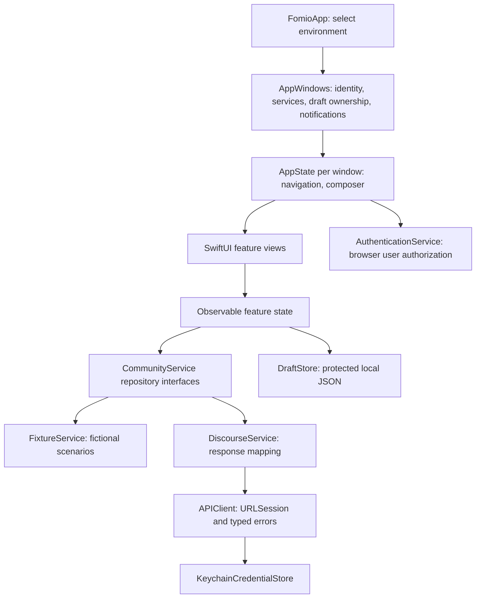

# Native app architecture

Implementation baseline: 2026-10-03. This describes the code currently present, not a deployed integration guarantee. Read [status](implementation-status.md) and [API evidence](discourse-api-reference.md) alongside it.

## Adaptive reading update — 2026-10-20

Native implementation is in progress; see [evidence and remaining acceptance](validation/2026-10-20-adaptive-native/README.md). `TabRoot` projects a tab's canonical route path into list and detail NavigationStacks inside one NavigationSplitView. Width and scaled readable-column minima choose compact reading, list/detail and optional community sidebar. Detail identity, list/search anchors and composer ownership are independent of pane placement. Focused-reading preference survives temporary collapse. This is in-memory retention, not process restoration.

`CommunityScopePicker` uses the secured catalog/root-child hierarchy, local filtering and a single popover that adapts to a sheet. Header/sidebar/directory all call `selectScope`; topic search is separate from both local chooser and directory filters. C08 fallback metadata is identity-checked, account/request-guarded and merged into a browsing catalog without claiming a complete directory. Unknown scope cannot fall back to a global feed. Search/input/settings/results are partitioned by viewer/site/scope/locale and attempt identity.

`DiscussionSearchRequest` and `DiscourseService.search` enforce original-term validation, request allowlist, numeric category guard, discussion archetype, exact post identity and atomic metadata publication after full validation. A preliminary error-envelope decoder recognizes nonblank grouped errors before decoding unused facets. Grouped/contract failures preserve permitted same-key snapshots according to the failed operation. Explicit auth/visibility failures instead invalidate service, catalog, feed/discussion and other-tab search snapshots; the current error is rebased to the new permission revision and remains manual recovery. They do not erase credentials or drafts or downgrade to guest.

Search requests bypass HTTP cache reuse, and the URLSession delegate refuses their storage. Canonical API redirects retain configured origin/base path. Public introduction links use the same origin/base-path checks and supported exact-topic grammar. No new backend or authentication scope is introduced.

## Ownership and dependency flow

Swift 6 strict concurrency is enabled. Mutable app, repository and feature state is isolated to the main actor; network calls suspend through Swift concurrency. SwiftUI Observation owns UI updates. `FomioApp` creates shared `AppWindows` services and identity coordination. Each `FomioWindow` scene owns a separate `AppState` for navigation, search, reading and presentation; views access their window state through the environment. Shared identity broadcasts invalidate every window, while a draft can have one editor across all scenes (including an authentication suspension). This is a small explicit composition root, without a service locator or third-party dependency framework.

| Area | Source | Responsibility |
| --- | --- | --- |
| Composition/navigation | `Fomio/App/FomioApp.swift`, `AppState.swift` | Development/live selection, four tab stacks, sheets, auth intent, account and routing |
| Domain | `Fomio/Domain/Models.swift` | Typed identities, display models, thread pages, draft/upload/write outcomes |
| Interfaces | `Fomio/Domain/Repositories.swift` | Feed, community, discussion, search, notification, profile, bookmark, posting and upload contracts |
| Fixtures | `Fomio/Data/FixtureService.swift` | In-memory fictional content and deterministic failure/outcome controls |
| Live adapter | `Fomio/Data/DiscourseService.swift` | Source-informed endpoint calls, optional DTO decoding, domain mapping |
| Transport | `Fomio/Data/Network.swift` | Relative-root URLs, per-user headers, cancellation, status/error semantics, upload progress and logical links |
| Authentication | `Fomio/Data/Authentication.swift` | Browser authorization, callback validation, RSA decryption and Keychain credentials |
| Persistence | `Fomio/Data/DraftStore.swift` | Atomic protected JSON, account filtering, deletion and guest migration |
| Features | `Fomio/Features/` | Feed/directory, normalized discussion state, composer, account/supporting screens and cooked content |
| Visual system | `Fomio/Design/Theme.swift`, `Resources/` | Semantic styling, adaptive palette, reading column, wordmark and photo credits |
| Validation | `FomioTests/`, `FomioUITests/` | Domain/persistence/adapter tests and native journeys |

## Domain identity

`EntityID<Tag>` prevents confusing `TopicID`, `PostID`, `PostNumber` and `CategoryID`, even though their wire representation is numeric. Navigation uses topic ID and optional post number. Like/bookmark mutations use post ID; bookmark deletion uses the returned bookmark identity. A category with a parent is a subcommunity, not a separate model type.

`AccountID` is a local scope: guest, fixture, or live site URL plus username. It is not a backend user ID. The exact configured base URL participates in credential and account storage; normalize and retain it consistently before live rollout. Changing site URL or username may strand an older local account scope. No account migration tool exists yet.

## Navigation and retained state

`AppTab` defines Home, Communities, Notifications and Me. Each `TabState` owns its `Route` path, typed `BrowseScope`, feed/discussion caches, directory query/expansions and one retained `DiscussionSearchState`. `FeedView` receives an explicit originating tab; a background pane never resolves its search through `selectedTab`. Topic search replaces the list content and has no reserved field row when collapsed. Legacy Search routes present the same scoped feed/controller. Create/Reply/Quote/Resume present one composer with an explicit origin. Publication returns to that tab and opens the exact confirmed post, clearing stale feed/discussion caches; explicit publication/public-link destinations leave an unrelated scope so the requested target remains visible.

`FeedState` retains rows, pagination and reading anchor. `DiscussionState` normalizes posts by post ID, tracks roots/child lists, independent pagination, expanded branches, per-branch errors and highlighted target. Child branches begin collapsed. Three visible levels lead to a focused thread route. Exact-post context keeps at most two visible ancestors plus the target and reports truncated context.

The system tab view uses `tabBarOnly`. `TabRoot` projects each window’s retained navigation into a native `NavigationSplitView`, adding community navigation only when the actual window width and scaled reading minima allow it. Content uses a 620-point maximum reading column. Composer uses a large native sheet: `ComposerPresentationSizing` delegates to system form sizing for regular-width presenting windows and page sizing otherwise, with one editor view identity across width changes. Native bars and controls supply Liquid Glass; content remains flat. See [iPhone Duo preparation](iphone-duo-readiness.md) for validation limits.

Shared visibility invalidation pauses each active search at its updated viewer/query/scope instead of clearing its request identity and accidentally restarting another visible window. Private rows/cursors/settings are removed, while explicit Retry or a new user intent controls recovery. Search identity includes the account's authentication generation, including same-account reauthentication. A synthetic pause does not rebroadcast an access failure.

State retention is in memory for navigation, reading, branch expansion and search. Only drafts and credentials survive process termination. Supporting lists such as notifications/profile/Saved use view-local state and can reload after reconstruction. Do not describe every screen’s position as durably persisted.

## Transport and rendering

`APIClient` uses an ephemeral URLSession with a 30-second request timeout, injected credentials for tests, same-origin redirect checks, and optional upload progress. It attaches `User-Api-Key` and `User-Api-Client-Id` when available. It distinguishes authorization, denial, unavailable resources, validation, rate limiting, transport failure and uncertain writes. No automatic posting retry is configured.

Discourse DTOs decode optional permission/content fields and map into native domain models. Categories flatten recursive `subcategory_list`; deleted nested placeholders inherit topic identity when omitted. Root metadata is cached for later nested pages. Search uses post result order and exact post numbers rather than assuming a topic list expresses result order.

`CookedContent` renders supported text, links, quotes, code and public HTTPS images natively. Unsupported structures get an explicit original-post link. It is a lightweight markup parser, not a full HTML engine. Secure media and deployment-specific markup require further work. No embedded JavaScript executes.

## Security and persistence boundaries

Credentials live in Keychain using device-only protection. Drafts use app-container file protection until first user authentication and atomic JSON writes. Account isolation is enforced by filtering records, not separate encrypted account directories. File protection is not an additional application-level encryption scheme. Sign-out clears current-account drafts and credentials; it does not erase other accounts’ drafts or delete server posts.

Draft records are version 2 with version-1 decoding and quote/photo migration. Unknown versions are rejected; there is no corruption quarantine system. A malformed JSON file can fail a list operation. Photo bytes live in protected account-scoped files with atomic draft metadata and orphan reconciliation. Raw Discourse markup is persistence/submission authority; TextKit rich text is an editable projection. See [recovery behavior](flows-and-recovery.md).

## Extension rules

Add domain/interface behavior before adding endpoint assumptions to a view. Keep fixtures and live adapters behind the same repository contract. Record source evidence and live status when changing an adapter. Preserve independent draft/upload/auth/submission states and exact identities. Add meaningful tests for new contracts or recovery risks; never use fixture success as proof of deployed behavior.

## Category/topic presentation refinement — 2026-10-06

Community retains optional Discourse category identity assets/style/colors, excerpt and introduction URL. CategoryMark renders known icon/emoji identifiers and public HTTPS logo variants, with a category-color square fallback. The directory groups roots and immediate children, keeps server order and matching-child ancestry, and retains expansion/query in TabState. About uses the returned description and optional same-site introduction link. Root category feeds remain aggregate and label that scope.

AppState loads the site's default light/dark schemes through CommunityRepository. FomioTheme stores the app's single-site palette; Color providers capture immutable values for system appearance traits, and observed siteTheme updates mounted views without resetting tab paths. CSS, custom theme behavior and member scheme selection are not mirrored. Missing tokens retain the explicit native fallback. Theme fetching is independent of category permissions.

Discussion presentation adds the parent/child path, compact scaling titles, named author block, labeled Save/Like controls and exact-target outline. Existing normalized paging/context/navigation state remains authoritative. Effective root sort and archived status are now mapped; permission controls still use the viewer's returned flags. Category depth and reply depth remain independent.

## Topic cards and feed appearance — 2026-10-15

`TopicCard` (`Fomio/Features/TopicCard.swift`) replaces the former `TopicRow`. It takes one `DiscussionSummary`, a `FeedAppearance`, and explicit `onOpen`/`onCategory` callbacks, and is composed from `TopicCategoryLabel` (actual category mark plus optional parent context), `TopicMedia` (bundled fixture asset or verified remote `imageURL`; loading placeholder; failure removes the slot) and `TopicMetadata` (original author, reply count including zero, labeled activity; reflows from one line to stacked lines). Title, excerpt, media and metadata form one Discussion button; the category label is a sibling button, never nested. Title/excerpt keep their own script direction (`String.naturalDirection`) like HTML `dir="auto"`.

`FeedAppearance` (`compact` default, `cards`) is a device preference stored with `@AppStorage("feedAppearance")`. `FeedView` (Home and every category feed) reads it and shows a toolbar options menu beside Search/Create containing a native inline `Picker` with icons and a selected checkmark. There is no Settings screen. Both appearances render the same `FeedState` items, order, pins, pagination and error state; only presentation differs.

Switching preserves the reading position without animation: before the change, `FeedGeometry` (non-observed, so scroll updates do not re-render) identifies the first visible topic and its offset from the visible top. After relayout the feed scrolls that topic to the top, then uses a clamped `UnitPoint` placement — through the following topic when the anchor was partly above the top — so the same fraction remains hidden (or the same distance below the top when fully visible). Feeds hidden in a navigation stack restore from their own last-known geometry when another feed changes the shared preference. Back navigation keeps the existing `scrollPosition(id:)` anchor. Near the end of loaded content the system clamps the offset, so a shorter appearance can move the anchor down.

## Reporting & Safety — 2026-10-17 (superseded)

_Historical: build 0.8.0 (7) replaced this build 6 implementation; the sources named below were removed. Current safety code is `Data/DiscourseSafety.swift` and `Features/SafetyViews.swift`._

`Domain/Safety.swift` defines `ReportTarget` (post ID vs topic ID), `ReportReason`, `ReportContext`, `FlagAction`, `AccountSafety`, `MemberSafety`, `IgnoreDuration` and `SafetyRepository`. `CommunityService` now includes `SafetyRepository`. `Data/SafetyService.swift` is the live adapter: `site.json` catalog cached per service, fresh `posts/:id.json`, `post_actions.json`, `session/current.json`, `u/:username/card.json`, `u/:username/notification_level.json`, `about.json`. The fixture adapter in `FixtureService` simulates every designed outcome via launch arguments: `--report-outcome`, `--timeout-not-received`, `--ignore-outcome`, `--ignored a,b`, `--new-member`, `--ignored-list-fails`, plus presets `report`, `report-discussion`, `ignore`, `ignore-profile`, `staff-profile`, `hidden`, `safety`, `ignored-users`. `Features/SafetyState.swift` holds the report and Ignore state machines; `Features/SafetyViews.swift` the sheets, placeholder, Safety & Help and Ignored users. `AppState` owns account-scoped `safety`, `revealed`, the presented `report`/`ignoreSheet` and `safetyRevision`. `Post.flags` and `DiscussionPage.canFlagTopic` carry server permissions. Moderation stays in Discourse web tooling.

## Notifications — 2026-10-18

`Domain/Notifications.swift` defines `NotificationID` (distinct from topic/post IDs and post numbers), `NotificationKind` (known Discourse types plus `unknown(raw)`), the generic `NotificationItem` envelope, `NotificationResolver` (exact post, topic, grouped bucket, same-site website, unsupported), `NotificationCopy`, `NotificationHistoryPage` (raw-window `nextOffset`), `NotificationTotals` (server scope, 99 cap) and the typed `NotificationIntent`. `NotificationRepository` now exposes history, exact-ID mark-read and totals only; there is no bulk API.

`Features/NotificationStore.swift` is an `@Observable` account-scoped store owned by `AppWindows` and shared by every window (a stand-alone `AppState` in unit tests owns its own): per-filter feeds (ids, raw next offset, page error, empty-batch flag), rows by ID, acknowledgment states, totals, refresh status and the inbox anchor. A generation token discards results from a previous account; `reset(account:)` runs on sign-in changes and sign-out. `AppState.open(notification:)` resolves the destination, clears any cached state for that route and records the pending acknowledgment in the tab; `DiscussionView` calls `AppState.displayed(_:state:)` after a successful load, which acknowledges only when the exact target is present. Grouped focus (`FocusReason.groupedReplies`) makes `DiscussionState` expand the parent's replies.

`App/NotificationDevice.swift` separates `AlertPermissionProvider` (system or simulated) from `AlertEnrollmentService` (live: `UnavailableAlertEnrollment`; fixtures: simulated). `FomioAppDelegate` is the `UNUserNotificationCenterDelegate`; taps are parsed into intents and queued in `IncomingNotifications`. `AppWindows` installs the handler once and routes each tap to the window used most recently (the last to become key or active) that has finished restoring its account; a tap that arrives before any window is ready is held for the first one. Foreground delivery only triggers a refresh. No APNs registration, entitlement or relay client exists.

### Notifications with several windows — 2026-10-22

Merged with the iPad/Duo window model in `264c228`. One `NotificationStore`, one `NotificationDevice` and one duplicate-tap filter (`TapFilter`, ten seconds) live in `AppWindows`, so a read confirmed in one window updates rows, the Unread cursor and the badge in every window. Per window (`AppState`): the pending tap waiting for sign-in or the composer decision, read-on-display bookkeeping (`TabState.acknowledgments`), the composer guard and the website sheet.

| Event | Shared (once) | Each window |
|---|---|---|
| Tap | Duplicate filter; target is the most recently used ready window | Site/account/key checks, composer guard, navigation |
| Read on display | Exact-ID acknowledgment, rows, cursor, totals | Which route is waiting to acknowledge |
| Sign-out | Store reset to guest, device alerts detached, duplicate filter and held taps cleared | Pending tap, composer decision, tabs (and their acknowledgments) reset |
| Sign-in | Store rebound on an account change | Only the window that signed in opens the tap it held |
| Rejected key on a tap | `expireAuthentication()` marks every window signed out | Only the tapped window asks to sign in |
| Foreground / reconnect | 30-second throttle on the store; concurrent refreshes coalesce | — |

Single-window behaviour is unchanged. A window that closes (`closeWindow`) stops receiving taps.
