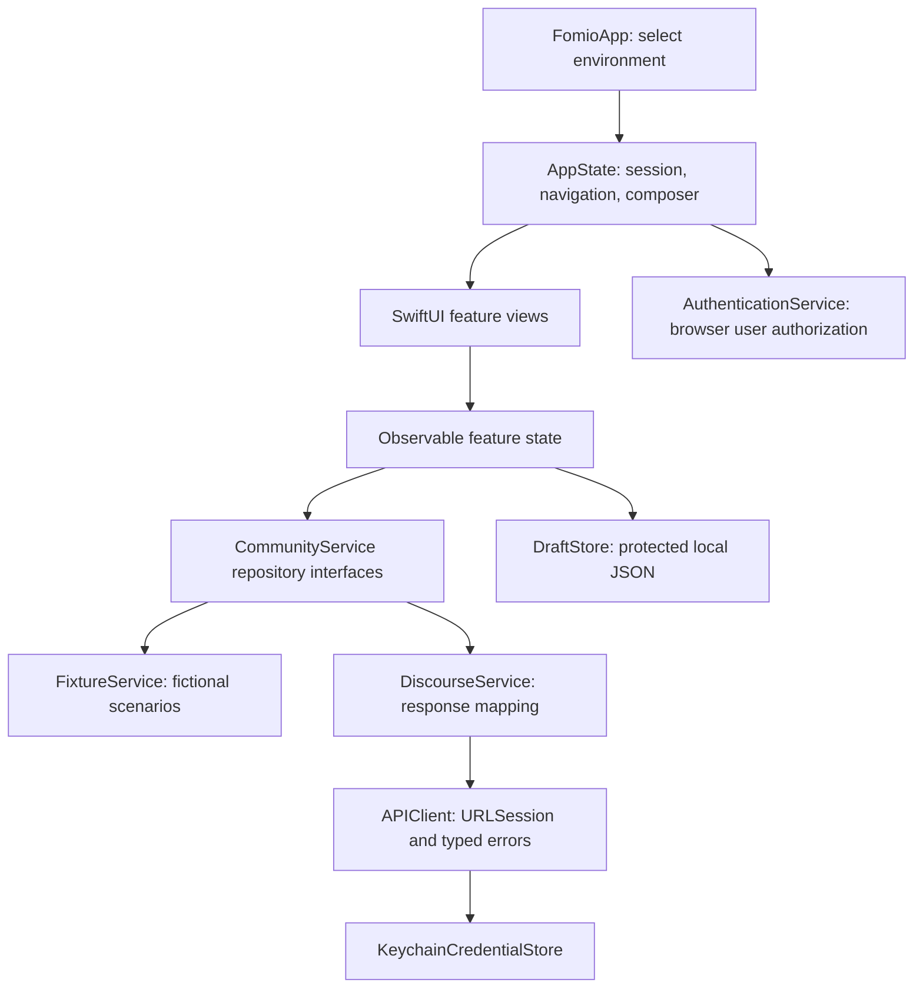

# Native app architecture

Implementation baseline: 2026-10-03. This describes the code currently present, not a deployed integration guarantee. Read [status](implementation-status.md) and [API evidence](discourse-api-reference.md) alongside it.

## Ownership and dependency flow

Swift 6 strict concurrency is enabled. Mutable app, repository and feature state is isolated to the main actor; network calls suspend through Swift concurrency. SwiftUI Observation owns UI updates. `FomioApp` creates one service and injects it through `AppState`; views access the app through the environment. This is a small explicit composition root, without a service locator or third-party dependency framework.

| Area | Source | Responsibility |
| --- | --- | --- |
| Composition/navigation | `Fomio/App/FomioApp.swift`, `AppState.swift` | Development/live selection, four tab stacks, sheets, auth intent, account and routing |
| Domain | `Fomio/Domain/Models.swift` | Typed identities, display models, thread pages, draft/upload/write outcomes |
| Interfaces | `Fomio/Domain/Repositories.swift` | Feed, community, discussion, search, notification, profile, bookmark, posting and upload contracts |
| Fixtures | `Fomio/Data/FixtureService.swift` | In-memory fictional content and deterministic failure/outcome controls |
| Live adapter | `Fomio/Data/DiscourseService.swift` | Source-informed endpoint calls, optional DTO decoding, domain mapping |
| Transport | `Fomio/Data/Network.swift` | Relative-root URLs, per-user headers, cancellation, status/error semantics, upload progress and logical links |
| Authentication | `Fomio/Data/Authentication.swift` | Browser authorization, callback validation, RSA decryption and Keychain credentials |
| Persistence | `Fomio/Data/DraftStore.swift` | Atomic protected JSON, account filtering, deletion and guest migration |
| Features | `Fomio/Features/` | Feed/directory, normalized discussion state, composer, account/supporting screens and cooked content |
| Visual system | `Fomio/Design/Theme.swift`, `Resources/` | Semantic styling, adaptive palette, reading column, wordmark and photo credits |
| Validation | `FomioTests/`, `FomioUITests/` | Domain/persistence/adapter tests and native journeys |

## Domain identity

`EntityID<Tag>` prevents confusing `TopicID`, `PostID`, `PostNumber` and `CategoryID`, even though their wire representation is numeric. Navigation uses topic ID and optional post number. Like/bookmark mutations use post ID; bookmark deletion uses the returned bookmark identity. A category with a parent is a subcommunity, not a separate model type.

`AccountID` is a local scope: guest, fixture, or live site URL plus username. It is not a backend user ID. The exact configured base URL participates in credential and account storage; normalize and retain it consistently before live rollout. Changing site URL or username may strand an older local account scope. No account migration tool exists yet.

## Navigation and retained state

`AppTab` defines Home, Communities, Notifications and Me. Each `TabState` holds its own `Route` path, feed cache, discussion cache, community query/expansions and search query/results/pagination/anchor. Search is pushed into the originating stack. Create/Reply/Quote/Resume present one composer with an explicit origin. Publication returns to that tab and opens the resulting exact post, clearing its stale feed/discussion caches.

`FeedState` retains rows, pagination and reading anchor. `DiscussionState` normalizes posts by post ID, tracks roots/child lists, independent pagination, expanded branches, per-branch errors and highlighted target. Child branches begin collapsed. Three visible levels lead to a focused thread route. Exact-post context keeps at most two visible ancestors plus the target and reports truncated context.

The system tab view is `sidebarAdaptable`; regular-width iPad offers native sidebar behavior. Content uses a 620-point maximum reading column. Composer uses a large native sheet and form presentation sizing. Native bars and controls supply Liquid Glass; content remains flat.

State retention is in memory for navigation, reading, branch expansion and search. Only drafts and credentials survive process termination. Supporting lists such as notifications/profile/Saved use view-local state and can reload after reconstruction. Do not describe every screen’s position as durably persisted.

## Transport and rendering

`APIClient` uses an ephemeral URLSession with a 30-second request timeout, injected credentials for tests, same-origin redirect checks, and optional upload progress. It attaches `User-Api-Key` and `User-Api-Client-Id` when available. It distinguishes authorization, denial, unavailable resources, validation, rate limiting, transport failure and uncertain writes. No automatic posting retry is configured.

Discourse DTOs decode optional permission/content fields and map into native domain models. Categories flatten recursive `subcategory_list`; deleted nested placeholders inherit topic identity when omitted. Root metadata is cached for later nested pages. Search uses post result order and exact post numbers rather than assuming a topic list expresses result order.

`CookedContent` renders supported text, links, quotes, code and public HTTPS images natively. Unsupported structures get an explicit original-post link. It is a lightweight markup parser, not a full HTML engine. Secure media and deployment-specific markup require further work. No embedded JavaScript executes.

## Security and persistence boundaries

Credentials live in Keychain using device-only protection. Drafts use app-container file protection until first user authentication and atomic JSON writes. Account isolation is enforced by filtering records, not separate encrypted account directories. File protection is not an additional application-level encryption scheme. Sign-out clears current-account drafts and credentials; it does not erase other accounts’ drafts or delete server posts.

Draft records are version 2 with version-1 decoding and quote/photo migration. Unknown versions are rejected; there is no corruption quarantine system. A malformed JSON file can fail a list operation. Photo bytes live in protected account-scoped files with atomic draft metadata and orphan reconciliation. Raw Discourse markup is persistence/submission authority; TextKit rich text is an editable projection. See [recovery behavior](flows-and-recovery.md).

## Extension rules

Add domain/interface behavior before adding endpoint assumptions to a view. Keep fixtures and live adapters behind the same repository contract. Record source evidence and live status when changing an adapter. Preserve independent draft/upload/auth/submission states and exact identities. Add meaningful tests for new contracts or recovery risks; never use fixture success as proof of deployed behavior.

## Category/topic presentation refinement — 2026-10-06

Community retains optional Discourse category identity assets/style/colors, excerpt and introduction URL. CategoryMark renders known icon/emoji identifiers and public HTTPS logo variants, with a category-color square fallback. The directory groups roots and immediate children, keeps server order and matching-child ancestry, and retains expansion/query in TabState. About uses the returned description and optional same-site introduction link. Root category feeds remain aggregate and label that scope.

AppState loads the site's default light/dark schemes through CommunityRepository. FomioTheme stores the app's single-site palette; Color providers capture immutable values for system appearance traits, and observed siteTheme updates mounted views without resetting tab paths. CSS, custom theme behavior and member scheme selection are not mirrored. Missing tokens retain the explicit native fallback. Theme fetching is independent of category permissions.

Discussion presentation adds the parent/child path, compact scaling titles, named author block, labeled Save/Like controls and exact-target outline. Existing normalized paging/context/navigation state remains authoritative. Effective root sort and archived status are now mapped; permission controls still use the viewer's returned flags. Category depth and reply depth remain independent.

## Topic cards and feed appearance — 2026-10-15

`TopicCard` (`Fomio/Features/TopicCard.swift`) replaces the former `TopicRow`. It takes one `DiscussionSummary`, a `FeedAppearance`, and explicit `onOpen`/`onCategory` callbacks, and is composed from `TopicCategoryLabel` (actual category mark plus optional parent context), `TopicMedia` (bundled fixture asset or verified remote `imageURL`; loading placeholder; failure removes the slot) and `TopicMetadata` (original author, reply count including zero, labeled activity; reflows from one line to stacked lines). Title, excerpt, media and metadata form one Discussion button; the category label is a sibling button, never nested. Until `AppState` first loads communities (no list and no error yet), a card that shows its category keeps an invisible, accessibility-hidden `TopicCategoryPlaceholder` with the label's single-line metrics, so rows keep their height and the reading position does not move when a slow `loadCommunities()` finishes after the feed. If the load fails the placeholder is removed; a category missing from a loaded list shows no line, as before. Title/excerpt keep their own script direction (`String.naturalDirection`) like HTML `dir="auto"`.

`FeedAppearance` (`compact` default, `cards`) is a device preference stored with `@AppStorage("feedAppearance")`. `FeedView` (Home and every category feed) reads it and shows a toolbar options menu beside Search/Create containing a native inline `Picker` with icons and a selected checkmark. There is no Settings screen. Both appearances render the same `FeedState` items, order, pins, pagination and error state; only presentation differs.

Switching preserves the reading position without animation: before the change, `FeedGeometry` (non-observed, so scroll updates do not re-render) identifies the first visible topic and its offset from the visible top. After relayout the feed scrolls that topic to the top, then uses a clamped `UnitPoint` placement — through the following topic when the anchor was partly above the top — so the same fraction remains hidden (or the same distance below the top when fully visible). Feeds hidden in a navigation stack restore from their own last-known geometry when another feed changes the shared preference. Back navigation keeps the existing `scrollPosition(id:)` anchor. Near the end of loaded content the system clamps the offset, so a shorter appearance can move the anchor down.

## Interface localization — 2026-10-15

`Fomio/Localization/` owns interface text. `Localizer.shared` holds the active `LocalizationCatalog` (bundled English or a validated download) behind a `Mutex` and an `ObservationRegistrar`; `L(_:)`, `L(_:count:)` and `LText` resolve semantic keys from views, models and errors. `LocalizationController` (owned by `AppState`) keeps the member's explicit language choice (English by default; never chosen automatically), activates its validated cache synchronously at launch, and refreshes through a `LocalizationTransport` (`DiscourseLocalizationTransport` against the `discourse-fomio-app-locales` plugin's public endpoints for live builds, `FixtureLocalizationTransport` in fixture mode, `UnavailableLocalizationTransport` when unconfigured). `CatalogValidator` gates every activation (schema 2: assembled catalogs with an English `fallback` list; `PluralRules` covers Discourse's 15 integer plural families). `Localizer` renders fallback messages with English rules and left-to-right isolation, and composes fragments in their container's language (`within:`). `LocalizationStore` persists last-good catalogs per site/relative root/schema/locale. `LocalizationEnvironment` sets `\.locale` and `\.layoutDirection` at presentation roots; view identity is unchanged, so navigation, drafts, uploads and editor selection survive a language change. The UIKit editor relabels in place when its environment changes and takes its direction from the catalog. A direction change also sets the `UIView` appearance direction (for UIKit-presented menus) and rebuilds the tab container by identity; tab paths and per-tab state are in `AppState`, so they survive. `DisplayError` keeps app-authored errors semantic until rendering and Discourse messages verbatim. See [localization strategy](localization-strategy.md).

Topic media use `MediaLoadState`: a failed source stays hidden until the next successful explicit refresh retries it once, or until the topic has a different source; only that deliberate retry creates a new load attempt, so a recovered image keeps its view identity on later refreshes. When the iOS and interface directions differ, the navigation bar's back indicator is supplied so the native Back chevron follows the interface direction.
