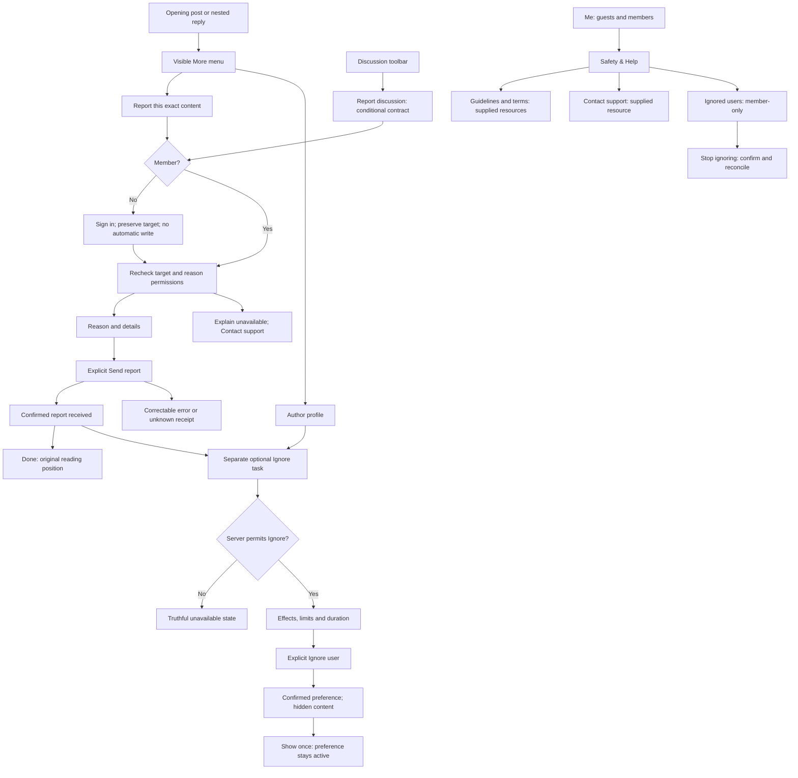

# Wireframe contract for review

2026-10-16. Structural proposal to check against Claude’s generated wireframes and mockups. This is not an accepted visual design or implemented app behavior.

## Entry and task flow



## Primary wireframe layouts

These zones are semantic; use native controls and adaptive spacing in mockups.

### R03/R04 — Report form

```text
┌──────────────────────────────────────┐
│ Cancel           Report reply        │
├──────────────────────────────────────┤
│ Discussion · Author · Reply number   │
│ Bounded excerpt of exact target      │
│                                      │
│ Why are you reporting this?          │
│ ○ [Server reason]                    │
│   [Server description]               │
│ ○ [Server reason requiring details]  │
│                                      │
│ Details [only when supported]        │
│ [Multiline field]                    │
│ [Inline error, if relevant]          │
│                                      │
│ [Send report]                        │
└──────────────────────────────────────┘
```

Send stays unavailable until required fields are valid and locks during submission. Keep target context, selected reason and typed details through correctable errors and re-authentication. A timeout opens an unknown-receipt state with a state-refresh action; it must not reuse an ordinary Retry submit button. Cancel with edits offers Keep editing and Discard report; this discards only the unsent form. Reasons shown in design are a sample catalog, not a fixed native taxonomy.

### R06 — Report received

Confirmed receipt, concise acknowledgement, Done as the primary action. Optional “Ignore user” begins a separate explicit task with its own effects and duration. Do not imply content removal, moderator agreement, an SLA, anonymity, automatic Ignore, a public flag count or a report-tracking record.

### I02 — Ignore user

```text
┌──────────────────────────────────────┐
│ Cancel            Ignore user        │
├──────────────────────────────────────┤
│ [Avatar] Display name · @username    │
│                                      │
│ What Ignore does                     │
│ Hide their posts and suppress new    │
│ personal messages/post notifications │
│                                      │
│ They can still read and reply to     │
│ public discussions.                  │
│                                      │
│ Duration                 Forever  ›  │
│                                      │
│ [Ignore user]                        │
└──────────────────────────────────────┘
```

Copy must match the accepted, tested backend contract. Duration can be chosen without another stacked sheet. Confirmed success updates content and the account’s list. Unknown receipt is reconciled before showing success. Do not offer Mute as a substitute when Ignore is denied. Current new-member ineligibility and self/staff restrictions need explicit reference variants.

### I04/I05/I06 — Hidden content and management

Keep author identity and thread context with “Content from an ignored user” and explicit Show once. Render ignored OPs and attributed quotes consistently, not only server-marked replies. Revealing does not stop Ignore. The list under Me → Safety & Help shows each ignored account and a Stop ignoring action, with honest empty/loading/error variants. Removing Ignore refreshes authoritative state and does not claim to restore an earlier mute.

### H02/H03 — Safety & Help

Guidelines, terms, Contact support and an explanation of Report versus Ignore remain accessible signed out. Ignored users is member-only. Policy and contact details are pending supplied resources; annotate this in the review frame, never fabricate a live email or URL. Profile abuse uses a clearly contextual support escalation until a dedicated supported report contract exists.

## Recovery and non-user surfaces

- R07–R11: already reported/handled, denied/removed target, sign-in return, expired authorization, validation/rate limit/offline, unknown receipt and discard input.
- I07–I08: unavailable/new-member and staff/self cases, expired/denied/uncertain preference writes, profile escalation.
- P01–P02: use existing composer error and pending-review patterns; retain writing and never label pending as published.
- O01–O02: service map and backend/operations checklist outside native end-user screens. No invented moderator inbox or reporter dashboard.
- A01–A03: iPad form sheet/popover, large text with keyboard, RTL and text/icon-supported error cues. Visible controls remain reachable without clipping or color-only meaning.

All browser interactions simulate outcomes; none sends reports, support messages or preferences to Discourse.
