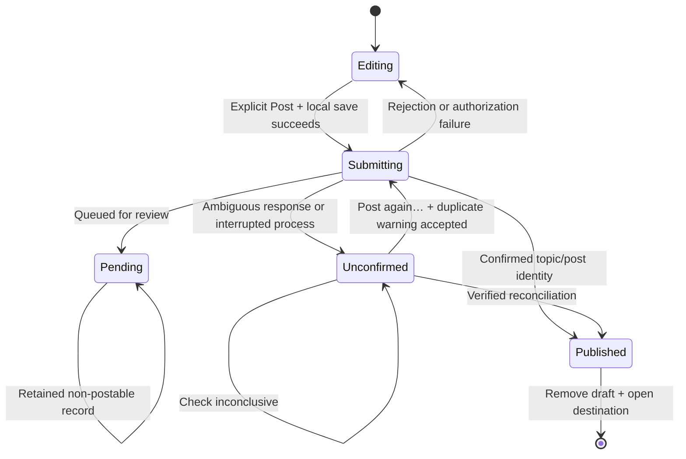

# User flows and recovery contract

This records current native behavior and its limits as of 2026-10-03. Discourse remains authoritative for live visibility, permissions, validation and moderation.

## Screens and actions

| Entry | Current behavior |
| --- | --- |
| Home | Latest feed, available category context/title/excerpt/author/activity/reply count and optional photo; no feed Like count |
| Communities | Flat directory with parent/child context, two children initially visible, expansion and local “Find communities” filtering |
| Community | Shared parent/child feed screen; Create inherits the permitted category |
| Discussion | Opening post, nested replies, contextual Reply/Quote/Like/Save/Share; independent roots and child pagination |
| Search | Discussion search inside originating tab; query/results/pagination/anchor retained in that tab’s memory |
| Notifications | Replies/mentions; resolve topic plus optional exact post number before marking read |
| Me/profile | Basic own/other-member profile and recent discussions; Saved, Drafts and sign-out |
| Composer | New discussion, reply, quote or resume using a native rich projection, authoritative raw text, inline photos and block forms |

Unavailable fields are omitted or use an honest fallback. Community artwork uses a letter when no verified logo exists. Live Share uses the configured site destination; fixtures cannot claim a real shared post URL.

## Authentication return intent

Guest Reply/Quote retains the intended post while presenting sign-in. Successful authentication reloads categories and rechecks the target’s reply permission/context before opening the composer. New discussion creation checks available permitted destinations. Neither flow posts automatically.

Global Create opens the composer directly with its “Post in” field closed and marked Required. Tapping it expands it in place into a search field over the communities the account can post in (a parent it can’t post in is a heading only). Each parent family opens and closes from a chevron showing its sub-community count; families start closed except the one holding the current choice, and tapping a postable parent’s name still chooses it. Search ignores open/closed state, matching community or parent names, with Return choosing the top match. The keyboard stays down until the person taps search. Contextual Create inherits its community. Choosing a community for an untouched draft is not a change: it neither prompts Keep/Discard on close nor writes a device record. A category topic template fills an empty body when the community is chosen.

Guest Like/Save returns to a refreshed discussion and asks the member to tap the action again. Authentication does not execute those mutations. Cancel clears pending intent. A different newly authenticated account closes the previous account’s composer and keeps that draft scoped to its owner. Guest drafts, if any, migrate to the newly authenticated account.

Explicit sign-out warns that current-account local drafts will be deleted. Draft cleanup and Keychain removal must succeed before the app reports sign-out complete. Operations are sequential, not transactional: partial deletion is possible if a later step fails, and the error is surfaced.

## Nested navigation

Opening a discussion loads its opening post and root page. Child branches begin collapsed behind labeled controls; expanding one fetches children separately. Pagination errors belong to the affected root/branch and do not erase loaded siblings. Loaded data and expansion live in the tab’s discussion cache.

At the visible indentation bound, “Continue this thread” opens focused context. An exact target route requests ancestor context, expands the visible chain, highlights and scrolls to the target. At most two ancestors plus target are visible; truncated context is announced. Deleted placeholders retain identity. Missing/private/denied context must remain an explicit error, without invented ancestry.

Fixtures expose an explicit unsupported-nesting state. Live 404 can mean disabled nesting, inaccessible topic or missing target, so it cannot by itself certify unsupported capability. The app never substitutes chronological replies; live acceptance requires enabled nested APIs.

## Composer readiness

Post requires member identity matching the draft’s account, editing state, nonempty raw body and resolved photo state. New discussions additionally require a nonempty title and an available category with create permission. Server validation can still reject a locally ready form because trust, tags or site-specific fields are authoritative.

Draft persistence, upload, authorization and submission are independent states. A photo upload does not publish a post. An expired authorization does not erase writing. A successful local save does not prove publication.

The live reconciliation adapter currently always returns unresolved. Pending records have no implemented automatic approval reconciliation. Unconfirmed offers Check again and Back first; Post in the header stays disabled. “Post again…” shows a duplicate warning, and only its explicit “Post again” button sends again. Nothing is retried automatically. Pending review closes the composer and shows a dismissable “Submitted for review” notice on the screen the post was written from; the locked local record stays in Drafts so it cannot be posted twice. Concurrent/repeated Post taps are blocked by the submitting state. There is no offline send queue or automatic posting retry.

## Local draft lifecycle

Text/title/category changes debounce autosave by 500 milliseconds. Backgrounding also attempts save. Atomic version-2 JSON records include UUID, account, intent, raw title/body/category, ordered attachment metadata and positions, submission state and timestamp. Version-1 records migrate without changing their identity or recovery locks. Only that account’s records are listed.

Before sending, the app saves a submitting record as **unconfirmed on disk**. Termination after the server may have accepted the request therefore restores a locked record rather than an editable duplicate. In-memory state stays submitting during the request.

Close with unchanged writing simply closes. Close after any change to title, text, community or photo presents Keep draft, Discard and Keep editing (“You changed this draft.” for a resumed draft). That choice is the confirmation, so Discard removes the local record directly; it does not delete a submitted server post. Keep closes only after local save succeeds. Drafts are not server-synchronized. Successful publication deletes the local record and restores origin; if cleanup fails, the app retains a locked record and reports that publication succeeded but cleanup failed. This cleanup fallback uses the current pending flag and is not evidence of moderation.

## Photo lifecycle

Picked photos are converted to JPEG and retained in protected account-scoped files before upload. Multiple inline attachments have stable identities, source positions, descriptions and independent status. Uploads run sequentially; cancellation/removal prevents a late response from restoring a removed attachment. Post stays disabled while an attachment is unresolved. Successful references replace their local placeholder in place and are submitted once.

Keeping a draft retains unfinished photo files. Resume shows explicit Resume upload/Retry or Remove; upload does not continue after termination. Missing/corrupt retained bytes preserve writing and block Post until resolved. Save failure keeps the composer open. Discard, successful post cleanup and sign-out remove owned retained files; orphan reconciliation follows atomic metadata writes. Files removed from the body remain available to native undo until draft cleanup. Fixture references are fictional and do not establish durable deployed media access.

## Honest failure states

Loading, empty and retry states exist across native lists. Discussion handles closed topics, deleted/ignored placeholders, denied/unavailable context and unsupported fixture capability. Errors preserve writing and loaded content where possible. No empty feed is used to hide a failed request, and no uncertain result is relabeled published.

See [release acceptance](release-readiness.md) for scenarios still requiring native-device and live evidence.

## Keyboard and focus — 2026-10-05

Composer opens with the keyboard down, including resumed drafts with missing-photo or submission recovery. Title and body have distinct native focus. The keyboard’s Next key moves from title to body; Return in the body inserts a newline. The floating composer bar (see [composer bar exploration](design/composer-bar-exploration.md), direction A) sits 8 pt above the keyboard, or above the safe area when the keyboard is hidden; it stays reachable with Show keyboard rather than disappearing. + adds a block after the captured block, the type chip changes the current block in place, and a text selection swaps in Bold, Italic, Link, Quote and Done. The bar hides while the community list is open and while input is locked. Dragging the composer, discussion search or community directory dismisses the keyboard interactively. Search submission and leaving search clear input focus without clearing the retained query.

Post clears input focus before sending. Command-Return invokes the same guarded Post action; Escape invokes Cancel with the existing Keep/Discard protection. Locked submission records cannot retain editing focus. Recovery changes reveal rejection, expired authorization, uncertainty, locked pending records, missing photos, failed uploads or generic errors with a scroll target and accessibility focus. Ordinary autosave and upload progress do not repeatedly move focus. Recovery scrolling respects Reduce Motion. Signing in again keeps the keyboard down and never posts automatically.

Cancel suspends editing focus. Keep editing restores the previous field if the same composer is still open and editable. Destination and photo presentations suspend focus and restore it after dismissal; the native editor snapshots and restores the insertion range rather than replacing editor text. Cancelling Add block preserves the captured focus state, including a hidden keyboard; choosing a new text block explicitly focuses its new caret. At accessibility text sizes the bar offers Add block, More and Done/Keyboard, with formatting and block transformations in More. Heading, quote and list prefixes are hidden in visual editing. Inline heading formatting is supported; visual selections map to source ranges. Markdown remains available in More, with a read-only rendered Preview and a source-mode Preview button. Returning restores the captured field and caret. Keeping/discarding a draft and publication close the composer. Backgrounding still saves changed drafts; focus on foreground return remains managed by the system.

Native SwiftUI safe areas position the formatting bar above docked keyboards; no fixed keyboard-height assumptions or global tap-to-dismiss gestures are used. Floating keyboards, physical keyboard navigation/shortcuts, VoiceOver announcements, real Photos picker dismissal, rotation, RTL and resized iPad windows still require device acceptance unless separately recorded in implementation status.

Design references: [Apple Virtual keyboards](https://developer.apple.com/design/human-interface-guidelines/virtual-keyboards), [Keyboards](https://developer.apple.com/design/human-interface-guidelines/keyboards), and [Focus and selection](https://developer.apple.com/design/human-interface-guidelines/focus-and-selection/). Apple search excerpts were read; the direct pages returned JavaScript shells in this session. This is source-informed implementation, not a claim of exhaustive HIG compliance.

### Refresh recovery correction — 2026-10-07

A successful topic refresh replaces the normalized reply cache and reloads reachable open branches; a retained reading anchor must exist in the fresh response. Removed children and empty branches disappear. Offline refresh retains content and expansion. Authorization/visibility failure discards the topic and its controls rather than showing previously permitted content. Older in-flight child/mutation results cannot repopulate the replacement cache. [Local regression evidence](validation/2026-10-07-audit-fixes/README.md).

## Reporting and Ignore — 2026-10-17

Contracts: [API reference](discourse-api-reference.md#reporting--safety-stage-2-contract-confirmation--2026-10-17). Design: [Reporting & Safety](design/reporting-safety/README.md).

- **Entry.** Every opening post and reply has a visible ••• (44 pt, “More actions for reply by …”). It offers Report post/reply, View profile, Save and Share; there is no message-the-author item. Report appears only for guests (sign-in gate), a post with flag `can_act`/`acted`, or a server-hidden ignored reply (rechecked on open). The discussion ••• shows **Report discussion** only when `details.can_flag_topic` is present. Profiles show **Ignore user**; profile ••• → Report a profile concern escalates to the published contact.
- **Report sheet.** Opening always refetches the exact post (`GET /posts/:id.json`), then intersects the server catalog (`site.json`, in server order, excluding `notify_user` and disabled types) with fresh `can_act`. Any `acted` flag → Already reported. No permitted reasons → Can't report, with support. 404 → target removed. Send report is the only submit path. It sits in the toolbar, is disabled until a reason is chosen, and requires non-empty details for `require_message` reasons, because the server accepts them without a message.
- **In flight and errors.** One request at a time. Inputs and Cancel lock, and swipe-down is disabled while sending or with edits. Cancel with edits asks Keep editing / Discard report. Offline sends nothing. 429 and 422 keep the reason and details. 401 suspends the sheet, signs in, then reopens the same target with input kept and rechecked; nothing is sent automatically. 403 is reconciled from the target's state (Already vs Can't report), never from localized text. Transport failure, 5xx or malformed 2xx → “We couldn't confirm your report”. Send stays unavailable until **Check status** reads `acted`.
- **Receipt.** “Report received” after a 2xx post payload only. Done returns to the same reading position. An optional, separate “Ignore {user}…” opens its own sheet after the report sheet closes.
- **Guests.** Report or Ignore from a guest stores the exact target. After sign-in it reopens and rechecks with no reason preselected and no write.
- **Ignore.** Shows effects and limits, defaults to Forever (1,000-year expiry, never displayed), with finite options showing approximate ends. Success only after `PUT notification_level` succeeds **and** the user card reports `ignored`. 422 (Discourse's denial status) → recheck card → truthful denied state. Unknown outcome → Refresh before any retry. Session ended → sign in, then confirm again. Self has no control. Staff get an explanation. Accounts without `can_ignore_user` get “Ignore isn't available for your account yet”.
- **Hidden content.** Server-hidden replies plus client-hidden opening posts, attributed cooked quotes (`aside[data-username]`) and draft quotes from ignored authors collapse to “… from someone you ignore · Show once”. Show once fetches server-blanked replies fresh and reveals for this launch only; Hide again collapses. Profile recent discussions collapse the same way. A confirmed change refetches loaded discussions.
- **Management.** Me → Safety & Help (guests and members): guidelines, terms and privacy from server paths; Reporting and ignoring explainer; Contact support only via the server-published `contact_email` (opens Mail, never sends); Ignored users (members). The list has loading/error/empty/refresh states and Stop ignoring with confirmation (“A mute you had before isn't restored”), reconciled from the card. No per-row duration, because the server doesn't expose expiry.
- **Accounts.** Ignore state, Show-once reveals and report/Ignore context are scoped to the account. They are cleared on sign-out, and a different member never inherits them. Report text is in memory only.
- **Previews outside discussions (2026-10-18).** Feed cards (excerpt and media), search snippets (matched post author) and reply/mention notifications from an ignored author collapse with Show once. They hide only when the payload names the author, and reveals are per item for this launch. Saved and link previews are not projected.
