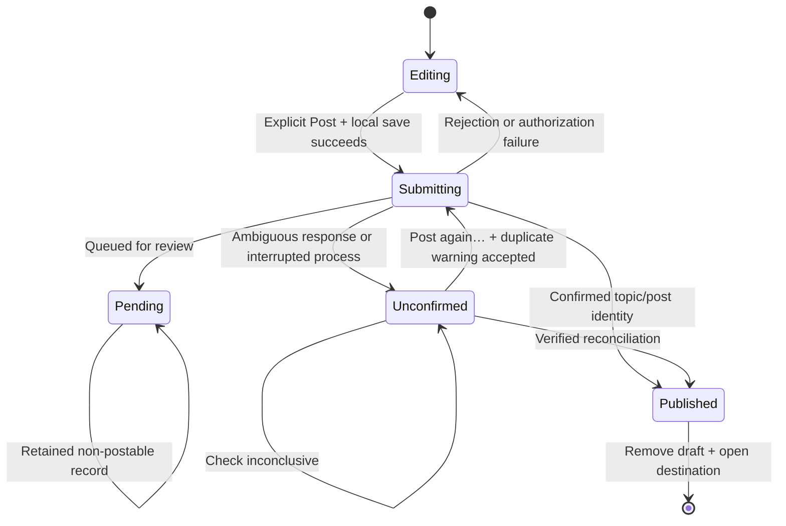

# User flows and recovery contract

This records current native behavior and its limits as of 2026-10-03. Discourse remains authoritative for live visibility, permissions, validation and moderation.

## Screens and actions

| Entry | Current behavior |
| --- | --- |
| Home | Latest feed, available category context/title/excerpt/author/activity/reply count and optional photo; no feed Like count |
| Communities | Flat directory with parent/child context, two children initially visible, expansion and local “Find communities” filtering |
| Community | Shared parent/child feed screen; Create inherits the permitted category |
| Discussion | Opening post, nested replies, contextual Reply/Quote/Like/Save/Share; independent roots and child pagination |
| Search | Discussion search inside originating tab; query/results/pagination/anchor retained in that tab’s memory |
| Notifications | Server history inbox (All/Unread read filter) retaining every type; exact, grouped and unsupported destinations; acknowledgment only after the destination is displayed. See “Notifications — 2026-10-18” below. |
| Me/profile | Basic own/other-member profile and recent discussions; Saved, Drafts and sign-out |
| Composer | New discussion, reply, quote or resume using a native rich projection, authoritative raw text, inline photos and block forms |

Unavailable fields are omitted or use an honest fallback. Community artwork uses a letter when no verified logo exists. Live Share uses the configured site destination; fixtures cannot claim a real shared post URL.

Submission preparation (2026-10-18): Me also exposes site policy/contact links for guests and members, account settings on the website for members, and a native Delete account sheet. The sheet checks the server's current-user permission, requires the exact username plus final destructive confirmation, then rechecks identity/permission before DELETE. An explicit server success triggers the existing account-scoped draft/credential cleanup. Cleanup failure keeps a completed-deletion screen with Finish sign-out; it never repeats DELETE. Ambiguous deletion offers website/support checks instead of a blind retry. Ineligible members see support guidance. That fallback is not claimed as complete App Store deletion acceptance for every account. Fixture accounts deny deletion and cannot delete a real account.

## Authentication return intent

Guest Reply/Quote retains the intended post while presenting sign-in. Successful authentication reloads categories and rechecks the target’s reply permission/context before opening the composer. New discussion creation checks available permitted destinations. Neither flow posts automatically.

Global Create opens the composer directly with its “Post in” field closed and marked Required. Tapping it expands it in place into a search field over the communities the account can post in (a parent it can’t post in is a heading only). Each parent family opens and closes from a chevron showing its sub-community count; families start closed except the one holding the current choice, and tapping a postable parent’s name still chooses it. Search ignores open/closed state, matching community or parent names, with Return choosing the top match. The keyboard stays down until the person taps search. Contextual Create inherits its community. Choosing a community for an untouched draft is not a change: it neither prompts Keep/Discard on close nor writes a device record. A category topic template fills an empty body when the community is chosen.

Guest Like/Save returns to a refreshed discussion and asks the member to tap the action again. Authentication does not execute those mutations. Cancel clears pending intent. A different newly authenticated account closes the previous account’s composer and keeps that draft scoped to its owner. Guest drafts, if any, migrate to the newly authenticated account.

Explicit sign-out warns that current-account local drafts will be deleted. Draft cleanup and Keychain removal must succeed before the app reports sign-out complete. Operations are sequential, not transactional: partial deletion is possible if a later step fails, and the error is surfaced.

## Nested navigation

Opening a discussion loads its opening post and root page. Child branches begin collapsed behind labeled controls; expanding one fetches children separately. Pagination errors belong to the affected root/branch and do not erase loaded siblings. Loaded data and expansion live in the tab’s discussion cache.

At the visible indentation bound, “Continue this thread” opens focused context. An exact target route requests ancestor context, expands the visible chain, highlights and scrolls to the target. At most two ancestors plus target are visible; truncated context is announced. Deleted placeholders retain identity. Missing/private/denied context must remain an explicit error, without invented ancestry.

Fixtures expose an explicit unsupported-nesting state. Live 404 can mean disabled nesting, inaccessible topic or missing target, so it cannot by itself certify unsupported capability. The app never substitutes chronological replies; live acceptance requires enabled nested APIs.

## Composer readiness

Post requires member identity matching the draft’s account, editing state, nonempty raw body and resolved photo state. New discussions additionally require a nonempty title and an available category with create permission. Server validation can still reject a locally ready form because trust, tags or site-specific fields are authoritative.

Draft persistence, upload, authorization and submission are independent states. A photo upload does not publish a post. An expired authorization does not erase writing. A successful local save does not prove publication.

The live reconciliation adapter currently always returns unresolved. Pending records have no implemented automatic approval reconciliation. Unconfirmed offers Check again and Back first; Post in the header stays disabled. “Post again…” shows a duplicate warning, and only its explicit “Post again” button sends again. Nothing is retried automatically. Pending review closes the composer and shows a dismissable “Submitted for review” notice on the screen the post was written from; the locked local record stays in Drafts so it cannot be posted twice. Concurrent/repeated Post taps are blocked by the submitting state. There is no offline send queue or automatic posting retry.

## Local draft lifecycle

Text/title/category changes debounce autosave by 500 milliseconds. Backgrounding also attempts save. Atomic version-2 JSON records include UUID, account, intent, raw title/body/category, ordered attachment metadata and positions, submission state and timestamp. Version-1 records migrate without changing their identity or recovery locks. Only that account’s records are listed.

Before sending, the app saves a submitting record as **unconfirmed on disk**. Termination after the server may have accepted the request therefore restores a locked record rather than an editable duplicate. In-memory state stays submitting during the request.

Close with unchanged writing simply closes. Close after any change to title, text, community or photo presents Keep draft, Discard and Keep editing (“You changed this draft.” for a resumed draft). That choice is the confirmation, so Discard removes the local record directly; it does not delete a submitted server post. Keep closes only after local save succeeds. Drafts are not server-synchronized. Successful publication deletes the local record and restores origin; if cleanup fails, the app retains a locked record and reports that publication succeeded but cleanup failed. This cleanup fallback uses the current pending flag and is not evidence of moderation.

## Photo lifecycle

Picked photos are converted to JPEG and retained in protected account-scoped files before upload. Multiple inline attachments have stable identities, source positions, descriptions and independent status. Uploads run sequentially; cancellation/removal prevents a late response from restoring a removed attachment. Post stays disabled while an attachment is unresolved. Successful references replace their local placeholder in place and are submitted once.

Keeping a draft retains unfinished photo files. Resume shows explicit Resume upload/Retry or Remove; upload does not continue after termination. Missing/corrupt retained bytes preserve writing and block Post until resolved. Save failure keeps the composer open. Discard, successful post cleanup and sign-out remove owned retained files; orphan reconciliation follows atomic metadata writes. Files removed from the body remain available to native undo until draft cleanup. Fixture references are fictional and do not establish durable deployed media access.

## Honest failure states

Loading, empty and retry states exist across native lists. Discussion handles closed topics, deleted/ignored placeholders, denied/unavailable context and unsupported fixture capability. Errors preserve writing and loaded content where possible. No empty feed is used to hide a failed request, and no uncertain result is relabeled published.

See [release acceptance](release-readiness.md) for scenarios still requiring native-device and live evidence.

## Keyboard and focus — 2026-10-05

Composer opens with the keyboard down, including resumed drafts with missing-photo or submission recovery. Title and body have distinct native focus. The keyboard’s Next key moves from title to body; Return in the body inserts a newline. The floating composer bar (see [composer bar exploration](design/composer-bar-exploration.md), direction A) sits 8 pt above the keyboard, or above the safe area when the keyboard is hidden; it stays reachable with Show keyboard rather than disappearing. + adds a block after the captured block, the type chip changes the current block in place, and a text selection swaps in Bold, Italic, Link, Quote and Done. The bar hides while the community list is open and while input is locked. Dragging the composer, discussion search or community directory dismisses the keyboard interactively. Search submission and leaving search clear input focus without clearing the retained query.

Post clears input focus before sending. Command-Return invokes the same guarded Post action; Escape invokes Cancel with the existing Keep/Discard protection. Locked submission records cannot retain editing focus. Recovery changes reveal rejection, expired authorization, uncertainty, locked pending records, missing photos, failed uploads or generic errors with a scroll target and accessibility focus. Ordinary autosave and upload progress do not repeatedly move focus. Recovery scrolling respects Reduce Motion. Signing in again keeps the keyboard down and never posts automatically.

Cancel suspends editing focus. Keep editing restores the previous field if the same composer is still open and editable. Destination and photo presentations suspend focus and restore it after dismissal; the native editor snapshots and restores the insertion range rather than replacing editor text. Cancelling Add block preserves the captured focus state, including a hidden keyboard; choosing a new text block explicitly focuses its new caret. At accessibility text sizes the bar offers Add block, More and Done/Keyboard, with formatting and block transformations in More. Heading, quote and list prefixes are hidden in visual editing. Inline heading formatting is supported; visual selections map to source ranges. Markdown remains available in More, with a read-only rendered Preview and a source-mode Preview button. Returning restores the captured field and caret. Keeping/discarding a draft and publication close the composer. Backgrounding still saves changed drafts; focus on foreground return remains managed by the system.

Native SwiftUI safe areas position the formatting bar above docked keyboards; no fixed keyboard-height assumptions or global tap-to-dismiss gestures are used. Floating keyboards, physical keyboard navigation/shortcuts, VoiceOver announcements, real Photos picker dismissal, rotation, RTL and resized iPad windows still require device acceptance unless separately recorded in implementation status.

Design references: [Apple Virtual keyboards](https://developer.apple.com/design/human-interface-guidelines/virtual-keyboards), [Keyboards](https://developer.apple.com/design/human-interface-guidelines/keyboards), and [Focus and selection](https://developer.apple.com/design/human-interface-guidelines/focus-and-selection/). Apple search excerpts were read; the direct pages returned JavaScript shells in this session. This is source-informed implementation, not a claim of exhaustive HIG compliance.

### Refresh recovery correction — 2026-10-07

A successful topic refresh replaces the normalized reply cache and reloads reachable open branches; a retained reading anchor must exist in the fresh response. Removed children and empty branches disappear. Offline refresh retains content and expansion. Authorization/visibility failure discards the topic and its controls rather than showing previously permitted content. Older in-flight child/mutation results cannot repopulate the replacement cache. [Local regression evidence](validation/2026-10-07-audit-fixes/README.md).

## Notifications — 2026-10-18

Implemented on branch `claude/fomio-notifications`; fixture and sanitized-stub evidence only. Discourse decides who is notified, consolidation, visibility and read state.

**Inbox.** Notifications tab shows server history (`offset`/`limit` ≤ 60, optional server `filter=unread`). Rows keep their server order and are updated by ID on refresh. Unread uses a dot, heavier text and the word “Unread”. Rows from members the account has Ignored stay hidden, with a count of hidden rows; a page that becomes empty after permission or Ignore filtering shows “Nothing unread in this batch… Keep looking”, never “That’s everything”. “That’s everything” appears only when the server total says history ended. Older pages load on scroll (All) or Show older; an older-page failure keeps loaded rows with Try again. Pull to refresh, app foregrounding (throttled to 30 s) and reconnecting re-read page 1 and totals; a failed refresh keeps rows with “Couldn’t refresh. Showing notifications from …”. Offline keeps rows and explains. Rows read on another device update in place with “Updated. N notification(s) were read on another device.” Consolidation that replaces a grouped row’s ID drops the old row and shows the new one; nothing duplicates. No MessageBus subscription exists (wire protocol unverified), so new rows appear on these triggers, not in real time.

**Badge.** The tab badge is the server `unread_notifications` total (unread rows newer than the seen cursor, minus new PMs, capped at 99 → “99+”). It never counts loaded rows and is never summed with other totals. The app never bumps the seen cursor. It can include old rows hidden locally by Ignore.

**Destinations.** Topic ID, post number and post ID stay distinct. Single replies, mentions, quotes, group mentions and other discussion types open the exact post (`discussion(topic, post number)`, highlighted “From your notification”) or the topic when post number is 1/absent. Grouped replies (`reply_to_post_number` + `consolidated_count` > 1) read “N new replies to your post/discussion”, never one author: bucket 1 opens the discussion newest first with a “N new replies to your discussion” line; any other bucket opens the focused parent post with its replies expanded (“Your post · N new replies”). Private messages, badges, group inbox summaries and unknown types with a topic offer “Open website” for a same-site URL in an in-app browser. Unknown types without any derivable link show “Fomio can’t show this notification… It stays in your inbox.” Back returns to the inbox with its list position.

**Acknowledgment.** Only after the destination loaded and the exact target is on screen (for grouped branches, after the parent's new replies also loaded; if they fail, the notification stays unread until Retry replies succeeds) does the app send `PUT mark-read` with that notification’s ID. Opening the tab, receiving a push, foregrounding or opening a website/unsupported row never marks anything. Failure: “Not marked as read. It stays unread.” + Try again (same ID). Network uncertainty: “Couldn’t confirm it was marked read.” + Check again, which looks for the row in server history: read → confirmed, unread → Try again; not found (e.g. now inaccessible) → stays unconfirmed. A confirmed read leaves the Unread list immediately without skipping older unread rows. Deleted/denied targets show “This post isn’t available… The notification stays in your inbox, unread.”; offline targets explain and stay unread. A missing ID can never reach the bulk mark-read path. Unsupported rows have no dismiss action yet (see the notification handoff).

**Device alerts.** Gear → Notification settings shows “This iPhone/This iPad” status combining OS permission and enrollment (Off, Not allowed, Allowed, Finishing setup, Setup didn’t finish, Updating, On) and the community’s website preferences. Live builds show **Not available yet**: no relay is configured, so the app neither asks for permission nor registers for remote notifications. Fixtures simulate: Turn on alerts → explanation (Not now never prompts) → labelled simulated system prompt → setup states with an injectable failure → Try again → On; Don’t Allow → Open iOS/iPadOS Settings (simulated screen). Wording follows the device idiom.

**Incoming taps (boundary implemented, delivery absent).** Typed payload keys only; the site must match the configured community; duplicates within 10 s are ignored. Signed out, or signed in with a key the community now rejects (checked first via the current session; Discourse returns 403 for revoked/expired keys) → “Sign in to open this notification”; the target is kept in memory without fetching protected content and routed after sign-in as the same member (a different member sees “This notification is for another account”). A changed or locked composer is never interrupted: “Open the notification?” offers Keep Writing (default) or Save Draft and Open; Keep Writing shows “Notification waiting” in the composer, and closing the composer routes it. Nothing is posted automatically. A payload without a notification ID opens the target but is not acknowledged. Sign-out clears rows, totals, pending taps and acknowledgments, and detaches enrollment.
