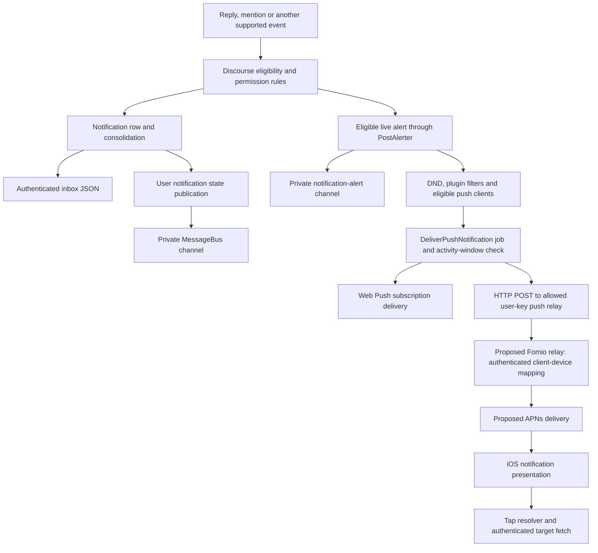
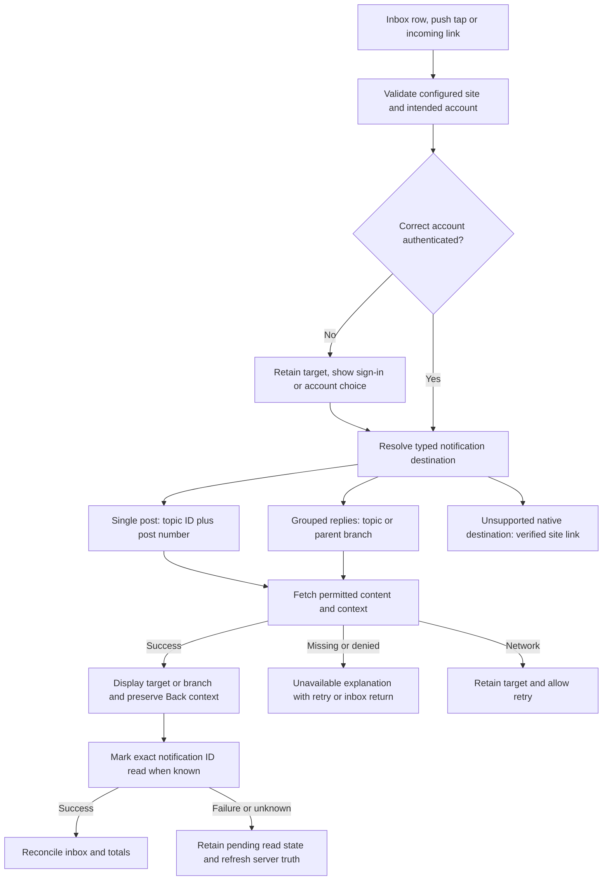
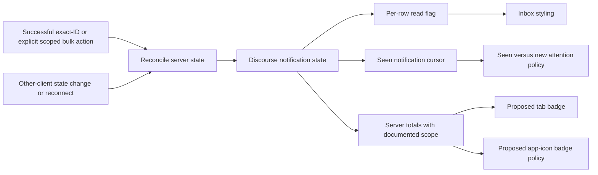
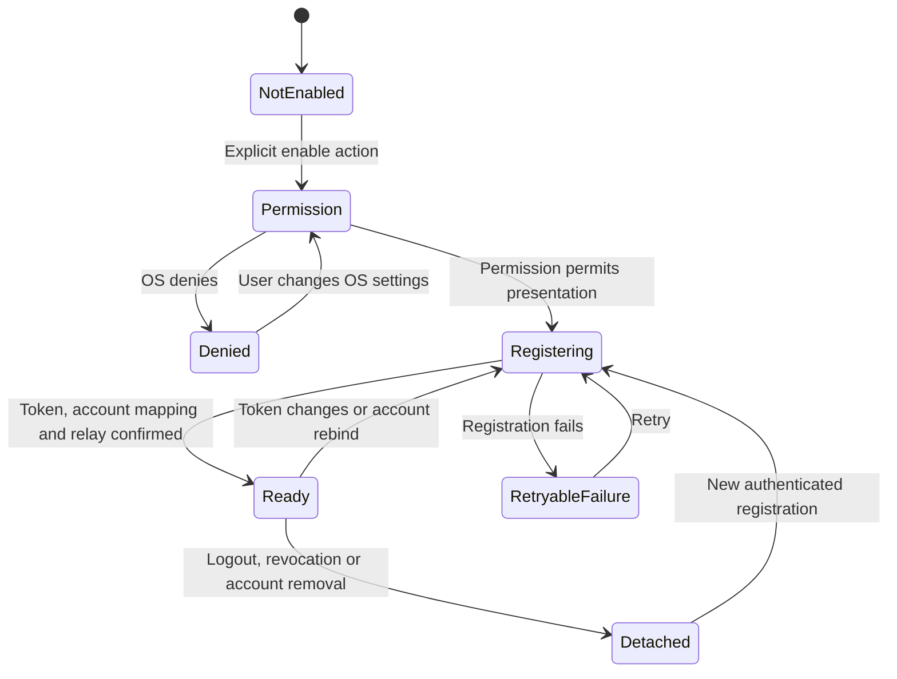

# Notifications — information architecture and integration map

Recorded: 2026-10-18. Status: source-grounded planning, before implementation or mockups. “AI maps” means IA, route maps and Discourse behavior research, as in the [IA build guide](ia-build-guide.md). This task changes documentation only. Push is now a pre-public-launch planning requirement; the earlier MVP exclusion is historical, not evidence of delivery.

## Method, authority and evidence

Uses the same Discourse Archeologist workflow as [category/topic IA](category-topic-ia.md): client trigger → route → controller → service/model → database → jobs → MessageBus → serializer → permissions/specs → native gap → acceptance.

Skill read: `/Volumes/Develop/Projects/Fomio/.cursor/skills/discourse-archeologist/SKILL.md`. Its Expo and relative `discourse/` wording is historical; this client is SwiftUI and the backend reference is `/Volumes/Develop/Projects/Dicourse`. Freshly checked HEAD: `d4296c5ecf2bef4f11e42d8f3fd2282c8752f4e2`. Backend source remained read only. All backend paths below are relative to that checkout and revision.

**Source reviewed:** files and spec assertions inspected, not executed. **Native inspected:** current working-tree Swift, including existing uncommitted changes. **Proposed:** recommended behavior requiring implementation and acceptance. **Deployed pending:** no fresh HTTP calls, notification writes, settings changes, relay provisioning or device delivery in this task. Earlier dated member read evidence in [API reference](discourse-api-reference.md) does not prove push delivery or mark-read behavior.

Discourse remains authoritative for who receives notifications, visibility, Ignore/mute, tracking, consolidation, read state and posting permissions. OS permission, server preference, device registration and successful delivery are distinct states. No deployed relay, APNs credentials, enabled plugins or new site settings are assumed.

| Evidence | Source and identifiers |
| --- | --- |
| E1 — inbox | `config/routes.rb` notifications resource; `app/controllers/notifications_controller.rb#index/#mark_read/#totals`; `lib/guardian/user_guardian.rb#can_see_notifications?` |
| E2 — identity/data | `db/structure.sql`: notifications, users, user_api_keys, user_api_key_clients, user_api_key_scopes, push_subscriptions, user_options; `app/models/notification.rb#types/#read/#read_types` |
| E3 — JSON | `app/serializers/notification_serializer.rb`; `user_notification_total_serializer.rb`; `app/models/user.rb#publish_notifications_state` |
| E4 — generation | `app/services/post_alerter.rb#create_notification/#create_notification_alert/.push_notification`; `app/models/notification.rb#refresh_notification_count/#send_email`; `Notifications::ConsolidationPlanner` |
| E5 — grouped replies | `frontend/discourse/app/lib/notification-types/replied.js#linkHref/#label`; `app/models/notification.rb#consolidated_nested_replied_url`; `PostAlerter#create_notification` |
| E6 — push | `app/jobs/regular/deliver_push_notification.rb#execute`; `app/services/hub_push_notification_pusher.rb.push`; `push_notification_pusher.rb.subscribe/.push/.send_notification`; `app/controllers/push_notification_controller.rb` |
| E7 — user auth | `app/models/user_api_key.rb#has_push?/.push_clients_for`; `user_api_key_scope.rb::SCOPES`; `app/controllers/user_api_keys_controller.rb#create`; `config/site_settings.yml` user_api section |
| E8 — realtime | `app/models/user.rb#publish_notifications_state`; `PostAlerter.create_notification_alert`; `config/initializers/004-message_bus.rb#setup_message_bus_env` |
| E9 — request/spec evidence | `spec/requests/notifications_controller_spec.rb`, `user_api_keys_controller_spec.rb`, `push_notification_controller_spec.rb`; `spec/services/hub_push_notification_pusher_spec.rb`, `post_alerter_spec.rb`; `spec/jobs/deliver_push_notification_spec.rb`; `spec/serializers/user_notification_total_serializer_spec.rb` |

## Map 1 — notification generation and delivery



The inbox row is durable server state; an alert/push is a delivery attempt, not a second inbox item. Not every type creates an alert through the same producer. `PostAlerter` checks Guardian receive permission, actor Ignore/mute, topic/group mute and deduplication; its push path checks DND, registered plugin filters and eligible subscriptions/clients. `DeliverPushNotification` can suppress delivery when recently seen. Do not recreate these rules in Swift or generate local alerts merely because a row appears (E4, E6).

## Map 2 — navigation, authentication and read outcome



**Native proposal:** resolve and display before acknowledging read. Push receipt, inbox opening, app foregrounding and an OS badge update must not automatically mark all read. A target without a known notification ID must not call mark-read without `id`: that performs a bulk mutation (E1, E2).

An exact post number is not a post database ID. For grouped `replied` rows, `data.reply_to_post_number` plus `data.consolidated_count > 1` changes web navigation: bucket 1 opens the topic; another bucket opens its parent level with `sort=new&collapse_replies=true`. Native must preserve that intent as a typed topic/branch destination rather than treating the group as one author's exact reply. This Swift mapping is proposed and needs native parity tests (E5).

Keep sign-in return intent; never send a reply automatically. Do not interrupt a changed composer to route a push tap: retain the pending target and let the user finish or safely leave writing. Cross-account targets must never fetch with the wrong account's key. Validate web fallback URLs against the configured site's origin/base path; do not launch arbitrary payload URLs. These are proposed client rules, not existing backend guarantees.

## Screen and state inventory

| ID | Surface/state | Semantic content and behavior |
| --- | --- | --- |
| NT01 | Guest inbox | Explain sign-in, retain destination through auth cancellation/retry; no member data |
| NT02 | Inbox | Notification meaning, actor(s) when supplied, topic/context, time, unread cue, continuation; truthful supported scope |
| NT03 | Empty | Distinguish genuinely empty, no unread, and no items in supported types; filtered-out page is not end-of-history |
| NT04 | Loading/recovery | Initial loading, retained refresh data, offline/stale status, independent next-page failure and retry |
| NT05 | Exact post | Current topic and ancestry/context, visible target, Back to original inbox position |
| NT06 | Grouped replies | Server count and topic/parent branch context; do not label every group “X replied to you” |
| NT07 | Unavailable | Deleted, revoked visibility or unsupported target explanation; retry, return, safe website fallback where verified |
| NT08 | Read action | Exact-ID acknowledgment; failure/unknown outcome; deliberate bulk action only with clear scope |
| NT09 | Notification settings | Proposed device delivery status, OS settings recovery, separate server preference link; never equate permission with delivery |
| NT10 | Push onboarding | Contextual explanation, explicit enable action, permission undetermined/denied/authorized or other OS status, registration pending/failure |
| NT11 | Incoming notification | Foreground, background, cold start, auth expired, account mismatch, duplicate/out-of-order tap, active composer |
| NT12 | Reconciliation | Other-device read, new event while paging, stale cursor, reconnect, token rotation, logout and account switch |

Presentation acceptance: iPhone/iPad, dark/light, Dynamic Type, RTL, VoiceOver semantic meaning/read state/time, and an unread indicator that does not rely solely on color. This is a semantic design brief, not a new visual mockup.

## Type and destination coverage

Enum presence is source evidence, not proof a plugin is enabled or a type occurs on the deployed site (E2).

| Family | Source types/examples | Proposed disposition |
| --- | --- | --- |
| Direct discussion interactions | mentioned=1, replied=2, quoted=3, group_mentioned=15 | First delivery slice; exact post except grouped reply rules above |
| Discussion activity | edited=4, liked=5, posted=9, moved_post=10, linked=11, invited_to_topic=13, watching_first_post=17, liked_consolidated=19, post_approved=20, bookmark_reminder=24, watching_category_or_tag=36, linked_consolidated=39 | Audit each type's data, copy and target before native support; do not coerce to reply/mention |
| Account and community | granted_badge=12, membership_request_accepted=22, new_features=37 and other core system types | Dedicated destination or safe verified web fallback; no invented topic target |
| Private messages | private_message=6, invited_to_private_message=7, group_message_summary=16 | Existing PM permissions and web destination; native PM feature remains separately scoped |
| Plugin/custom | custom=14, reaction=25, chat types, assigned=34 and others | Unknown/native-unsupported handling; verify actual producer and enabled feature before implementation |

Recommendation: retain a generic typed envelope and unknown-type fallback now, then enable only verified renderers/resolvers. An “All notifications” label requires honest handling of all returned types, not silently dropping everything except 1/2. Exact fallback contracts for non-discussion types remain open; this task does not claim a complete per-type route audit.

## Map 3 — read state, seen state and badges



`recent` and history are different contracts. History supports `offset`, `limit` (maximum 60), `filter=read|unread`, total rows and continuation. It parses `filter_by_types` but does not apply it in the history branch. Recent uses a prioritized bounded list with type filtering, not history pagination; without `silent`, it can bump the seen cursor. Neither “seen” nor fetching the list is the same as explicitly setting every row read (E1).

History totals are counted before inaccessible-topic/disabled-badge removal; a short or client-filtered empty page need not mean the end. Pagination must advance using the raw server window/continuation, not the displayed count. Refresh must reconcile changed rows by ID, not merely ignore already-present IDs (E1).

`UserNotificationTotalSerializer#unread_notifications` is all unread minus new-PM notification count; separate PM, review, tracking and group-inbox fields have different meanings. It is not a replies-and-mentions count. Proposal: use a verified community-notification badge scope consistently and explain excluded destinations, or keep a clearly scoped replies/mentions surface until an exact matching total strategy is established. Do not sum overlapping categories or count loaded pages as the global unread total. Totals/MessageBus numeric limits and blocked-content differences need contract acceptance before choosing the icon badge (E3).

## Map 4 — device delivery lifecycle (proposed)



Implementation must separately represent OS authorization and server/relay registration; “Ready” is registration status, not proof every push will display. Relay/APNs design remains a dependency: approved endpoint and ownership, authentication of device enrollment, site-to-relay verification, client/account/device binding, credential storage, token rotation/deletion, delivery retries/deduplication, expiry, privacy/preview content, retention, operational monitoring and sandbox/production configuration. No endpoints for these operations have been invented.

The source hub envelope includes `secret_key`, site `url/title/description`, and `notifications[]` carrying `client_id` and a canonical `url`. Site/relay secrets stay server-side; member actions keep per-user keys. Normal `PostAlerter` payload includes topic/post identities and excerpt, but does not supply a guaranteed notification ID. Relay and app cannot infer notification ID from post ID or rely on exactly-once delivery (E4, E6).

## Feature packets

### Inbox, totals and acknowledgment

**Goal:** Display an account's permitted notifications with truthful continuation, counts and read outcomes.

**Entry Point:** GET `/notifications.json`, GET `/notifications/totals.json`, PUT `/notifications/mark-read.json` → `NotificationsController` (E1).

**Client Trigger:** API-only native `NotificationsView`; web counterpart uses notification-specific renderers under `frontend/discourse/app/lib/notification-types/`.

**Server Path:** `index` → Guardian → `Notification` history/prioritized list → inaccessible-topic and badge filtering → acting-user population → serializer. `mark_read` → `Notification.read` or `read_types` → current-user state publication.

**Data Map:** notifications `id/user_id/notification_type/topic_id/post_number/data/read/high_priority`; users `seen_notification_id`. Read and seen differ. No member creation/edit/deletion of notification rows.

**Permissions:** Login required; own or administrator visibility through `can_see_notifications?`; exact-ID read scopes by current user. Notification CRUD uses admin gates. `UserApiKeyScope::SCOPES[:notifications]` permits index, totals, mark-read and MessageBus POST. Do not use admin keys.

**Async Side Effects:** Recent seen changes can publish state; bulk mark-read bumps the seen cursor. No push-send job is created by the inspected inbox/read actions.

**Realtime Side Effects:** `User#publish_notifications_state` publishes to `/notification/:user_id`, restricted by `user_ids`.

**Serializer/JSON Contract:** Notification serializer includes ID, type, read, high_priority, created_at, optional topic/post, title/slug, data and conditional actor identity. History includes total and continuation; recent includes seen cursor. Totals have their own scope (E3).

**Tests:** `notifications_controller_spec.rb`: history and continuation, recent type filtering, silent viewed state, inaccessible topics, exact read without affecting another row/user, typed read, guest denial and user-key index/totals. Reviewed, not run.

**Safest Extension Plan:** Native presentation and state over existing APIs; no backend extension established. A web Theme component can change presentation only. Consider a Plugin only if a demonstrated server contract is missing; no core patch justified.

**Verification Steps:** Run from backend checkout; commands 1–2 are source checks, command 3 is a proposed executable check, not run here.

```sh
rg -n 'def index|def mark_read|def totals|filter_by_types' app/controllers/notifications_controller.rb
rg -n 'notifications|can_see_notifications' config/routes.rb app/models/user_api_key_scope.rb lib/guardian/user_guardian.rb
bundle exec rspec spec/requests/notifications_controller_spec.rb spec/serializers/user_notification_total_serializer_spec.rb
```

### Generation, grouped replies and foreground freshness

**Goal:** Preserve Discourse notification intent and reconcile changes made on other clients.

**Entry Point:** Event producer → `PostAlerter#create_notification`; existing authenticated MessageBus middleware (E4, E8). No new Rails notification-subscription route is claimed.

**Client Trigger:** Proposed foreground coordinator subscribes with the current user's identity and reconciles inbox/totals on foreground/reconnect. Exact long-poll request/cursor wire format is pending client integration verification.

**Server Path:** Guardian/communication rules → `consolidate_or_create!` → notification callbacks; eligible alert → `create_notification_alert`.

**Data Map:** Notification rows and topic/post targets; grouped reply metadata in data. Group consolidation can replace IDs, so a native cache must tolerate disappearance/replacement (E4, E5).

**Permissions:** `can_receive_post_notifications?`, Ignore/mute, topic/group settings; MessageBus current user comes from `CurrentUser.lookup_from_env`; private channels publish with recipient user IDs.

**Async Side Effects:** Notification creation can process email or shelve during DND; eligible pushes have their separate job. Do not claim that native delivery replaces email preferences.

**Realtime Side Effects:** `/notification/:id` carries state, recent ID/read pairs and latest notification; `/notification-alert/:id` carries eligible alert content. Neither is a complete paginated history.

**Serializer/JSON Contract:** State contains unread counts, seen cursor, recent pairs, last notification and grouped counts; grouped reply row data controls branch targets (E3, E5). Treat signals as refresh triggers until the client protocol and reconciliation are verified.

**Tests:** `post_alerter_spec.rb`, notification request filtering/read tests and source grouped renderer. Execute focused consolidation/branch parity regressions during implementation; web renderer inspection is not native acceptance.

**Safest Extension Plan:** Swift coordinator plus existing API/MessageBus; assess web Theme presentation before any Plugin. No backend change required by current findings; polling on foreground/manual refresh is an explicit fallback, not background push.

**Verification Steps:**

```sh
rg -n 'create_notification|reply_to_post_number|consolidated_count' app/services/post_alerter.rb frontend/discourse/app/lib/notification-types/replied.js
rg -n 'publish_notifications_state|MessageBus.publish' app/models/user.rb app/services/post_alerter.rb
bundle exec rspec spec/services/post_alerter_spec.rb spec/requests/notifications_controller_spec.rb
```

### Push transport and enrollment boundary

**Goal:** Deliver eligible Discourse alerts to the correct native device without treating browser subscriptions as APNs registration.

**Entry Point:** Existing per-user key authorization carries optional `push_url`; eligible job → `HubPushNotificationPusher.push`. POST `/push_notifications/subscribe` instead accepts Web Push `subscription.endpoint/keys[p256dh,auth]` (E6, E7).

**Client Trigger:** Proposed enable flow, existing browser authorization extended only after approved relay enrollment design. Current native auth sends no `push_url`.

**Server Path:** `UserApiKey.has_push?/.push_clients_for` → eligible client list → job → hub HTTP POST grouped by push URL. Web path separately uses `PushNotificationPusher` → WebPush/VAPID.

**Data Map:** user_api_keys `user_id/user_api_key_client_id/push_url/revoked_at/expires_at`; client `client_id`; scopes `name`; Web Push uses push_subscriptions `user_id/data` and error fields. Native APNs device registry is not provided by this traced schema and must be designed/verified separately.

**Permissions:** Allowed scopes and allowed push URLs matter. `has_push?` accepts a notifications or push scope with allowed URL; `push_clients_for` additionally requires site-level `push` availability, active keys and eligible scoped clients. A scope alone does not enable delivery. Enrollment must prove account/device binding; `client_id` is routing data, not adequate enrollment authentication by itself.

**Async Side Effects:** `DeliverPushNotification` checks user existence/activity window, optionally localizes content, dispatches Web Push and hub separately. Legacy PushNotification/SendPushNotification jobs delegate to it. Hub error logging is not proof of durable relay retry or delivery acknowledgment.

**Realtime Side Effects:** Separate from foreground MessageBus. Background delivery must not depend on the app maintaining a foreground connection.

**Serializer/JSON Contract:** User-key encrypted authorization payload contains `key/nonce/push/api`; hub envelope is described above. Relay → APNs → native tap payload remains unestablished.

**Tests:** `user_api_keys_controller_spec.rb`: missing allowed push URL returns push=false, configured encrypted grant returns push=true; `hub_push_notification_pusher_spec.rb`: no clients, HTTP POST, envelope, URL grouping; `deliver_push_notification_spec.rb`: recently seen suppression, bypass, dual delivery, localization. Reviewed, not run.

**Safest Extension Plan:** Theme presentation cannot provide native device transport. Prefer an independently scoped relay using the existing hub boundary; inspect existing service compatibility before building one. A Plugin is a fallback for a demonstrated missing backend contract; no core patch is justified. Relay provisioning and backend settings/changes require their own authorized implementation task.

**Verification Steps:**

```sh
rg -n 'has_push|push_clients_for|push_url' app/models/user_api_key.rb app/controllers/user_api_keys_controller.rb
rg -n 'subscription|WebPush|hub_payload|client_id' app/controllers/push_notification_controller.rb app/services/push_notification_pusher.rb app/services/hub_push_notification_pusher.rb
bundle exec rspec spec/requests/user_api_keys_controller_spec.rb spec/services/hub_push_notification_pusher_spec.rb spec/jobs/deliver_push_notification_spec.rb
```

## Current native gaps and delivery order

| Order | Inspected gap | Proposed owner/change | Acceptance gate |
| --- | --- | --- | --- |
| 1 | `Notice.Kind` has only reply/mention; DTO drops group metadata and other types | `Domain/Models.swift`, `Data/DiscourseService.swift`: retain generic envelope and typed destination | Single/grouped replies, mention/quote, unknown/missing target decode safely; no wrong author/copy |
| 2 | Adapter requests history with ineffective type filter and locally discards other types; UI hides More when filtered page is empty | Notification repository/pager: explicit supported scope, raw continuation, dedup/update/replacement reconciliation | Empty intermediate page still reaches later supported rows; refresh updates read/content state |
| 3 | `NotificationsView.open` immediately changes local read/badge and starts mark-read before topic/context is fetched; failure leaves local read | Shared coordinator: resolve/display, exact acknowledgment, reconcile unknown writes | Deleted/denied/offline target retains honest read state; failed acknowledgment recoverable; never bulk by missing ID |
| 4 | `AppState.refreshUnread` counts page 0; inbox load counts loaded rows | Dedicated count contract/state with explicit scope | More than 30 rows, other-device read, ignored actor, PM/high-priority differences and stale failure covered |
| 5 | View-local inbox only loads initially/paging; no explicit refresh or realtime coordinator | Account-scoped notification store, foreground/manual refresh; MessageBus after protocol verification | Foreground/reconnect/auth switch resets correctly; cross-account requests/results discarded |
| 6 | No push URL in native auth, no notification framework registration/handling found, no push delivery configuration established | App lifecycle, notification permission/settings UI, typed tap resolver; external relay/device registry | Registration and token rotation; foreground/background/cold tap; composer preservation; sign-out detach |
| 7 | No real-device push evidence | Device/release validation packet | Approved test event produces correct account notification and exact/group target on distribution-signed device |

Paths in this table are relative to `Fomio/`. Existing exact-notification fixture/UI tests demonstrate only their tested navigation case; they do not close grouped intent, delivery or live mark-read gates. Existing docs saying “resolve before marking read” describe intent more strongly than the inspected code supports; use the actual gap above.

## Pre-public acceptance and unresolved dependencies

| Gate | Required evidence | Status in this task |
| --- | --- | --- |
| Inbox contract | Ordinary per-user account; supported type fixtures plus deployed samples; real pagination/filter behavior | Source reviewed; fresh deployed behavior pending |
| Read/count parity | Exact acknowledgment, failure/unknown response reconciliation, correct totals after web/iOS changes | Native gaps identified; implementation pending |
| Destination parity | Exact post and grouped branch; denied/deleted/missing; unsupported types; safe configured-site fallback | Source rules traced; native grouped resolver pending |
| Foreground freshness | Manual refresh, resume, reconnect and other-client read; no duplicate alerts | Proposed; protocol/live checks pending |
| Relay readiness | Actual approved URL/service, allowed-site settings, authenticated enrollment, APNs configuration, retry/retention/operations policy | Unknown; no relay or credentials inferred |
| Device delivery | Foreground/background/terminated app, production signing/environment, permission denied, token rotation, multiple devices/accounts, logout/revocation | Pending physical-device evidence |
| Safety/privacy | No cross-account content, no secrets in app/logs, appropriate preview content, expired/revoked mapping cleanup | Design requirement; implementation pending |

Implementation should close inbox/read/destination correctness first while establishing the relay contract, then add device permission/enrollment and delivery, then run end-to-end acceptance. This map does not authorize creating test posts/messages, changing Discourse settings, provisioning a service or accessing new credentials. Select approved test accounts and event method before live mutation tests.
