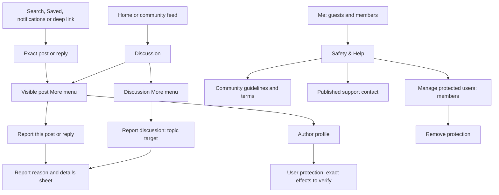
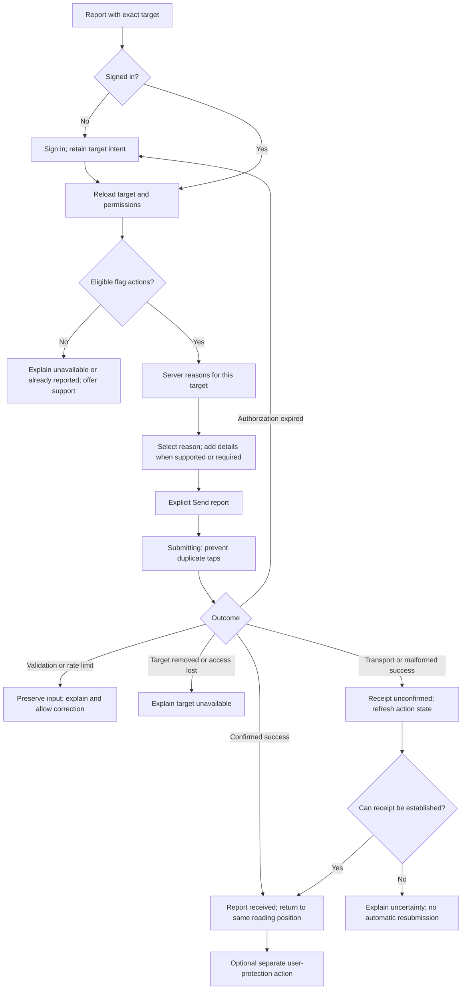
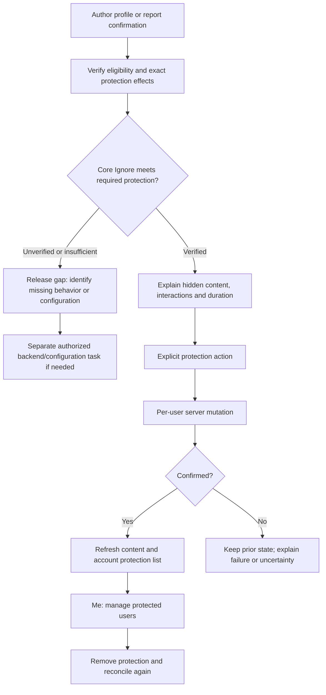

# Reporting and safety IA

Recorded: 2026-10-16. Status: proposed information architecture, before mockups and implementation. “IA” means information architecture. This pass adds documentation only. No reports, blocks, backend changes, live requests or moderator actions were performed.

## User-directed next stage — 2026-10-16

*(Superseded by the implemented feature; see [current status](design/reporting-safety/stage-gates.md#current-status--2026-10-18).)* Wireframe and mock up the complete reporting/Ignore/safety flow before implementation. Then apply and verify accepted backend behavior, then build the native app feature. The action is named **Ignore user**. Native implementation is paused. See the [design review and coverage inventory](design/reporting-safety/README.md). This supersedes the implementation order below wherever it would begin native work before backend validation.

## Recommendation and boundary

Build native reporting and user-protection flows around Discourse, with visible entry points and honest write outcomes. Keep Discourse authoritative for reasons, permissions, review handling, content removal and account sanctions. Use the existing Discourse web review queue for moderators initially; a native moderation console is outside this slice.

Reporting and blocking are separate actions. Reporting requests moderator attention; it does not promise removal or automatically protect the reporter from the author. Blocking should provide a clearly explained, verified protection. Do not rename Mute or Ignore to Block until their actual effects and availability meet the product requirement.

Read with [API evidence](discourse-api-reference.md#reporting-and-user-protection-source-review--2026-10-16), [architecture](architecture.md), [existing IA](information-architecture.md), [flows](flows-and-recovery.md), and [release readiness](release-readiness.md). This focused proposal extends the earlier launch scope for safety; it does not claim implemented behavior or App Review approval.

## Apple requirements and product coverage

Apple’s [App Review Guideline 1.2](https://developer.apple.com/app-store/review/guidelines/#user-generated-content), read 2026-10-16, requires filtering objectionable material from being posted, reporting with timely responses, blocking abusive users, and published contact information. A flag button addresses only part of this. The current wording does not specify a universal 24-hour deadline or two-tap reporting rule. Set and staff an internal response target before release; do not promise an unverified response time in the app.

| Requirement | Proposed owner and surface | Release evidence needed |
| --- | --- | --- |
| Filtering before publication | Discourse posting rules, configured filtering and approval/moderation facilities | Confirm actual enabled settings and coverage for text, links and uploads; test rejection and pending review. Existing pending-post UI is not evidence of adequate filtering. No AI moderation service is assumed. |
| Reporting and timely response | Native report sheet → Discourse flag/review system → staffed moderators | Fresh-member and established-member reporting; custom reasons; verified moderator receipt and handling; operational owner and response target |
| Blocking abusive users | Profile/post author action → verified user-protection contract; management under Me | Exact effects, persistence, expiry, new-account eligibility, notifications and interaction coverage, unblock, cross-device behavior; evaluate gaps in core Ignore |
| Contact information | Guest-accessible Me → Safety & Help → Contact support | Real published contact details and working destination; actual community guidelines/terms/support links |

The contact channel also gives people an escalation route when reporting is unavailable, but does not establish that disabled reporting or blocking is acceptable for release.

## Map 1 — entry points and screens

Proposed native navigation; conditional user protection remains a release gate.

- Add a visible More button to every reportable opening post/reply, including nested/exact contexts. A long-press menu can duplicate actions but must not be the only discoverable route. Existing `PostCard` currently exposes Save/Share through a context menu, without reporting.
- Keep topic reporting clearly separate from reporting the opening post. Defer the discussion-wide entry if deployed topic flagging cannot be confirmed; post reporting is the first vertical slice.
- Reporting content in feeds starts by opening the discussion. Do not infer a post ID from a topic ID or an absent first-post field.
- Profile gets a visible user-protection entry. Abuse in a bio/avatar needs a separately verified report route; core post flags do not establish profile-report support. Until resolved, provide the real support contact with profile context and treat profile abuse coverage as a release gate.
- Me → Safety & Help remains available signed out; its member-only management entry requires authentication.
- Do not expose staff-only immediate-action, warning or queue controls in member reporting.

## Map 2 — report journey and recovery

The sheet contains target context (author, discussion and a bounded excerpt), eligible reasons in server order, server descriptions rendered safely, details when supported/required, and Cancel/Send report. Proposed presentation uses native menus and a sheet; Apple HIG pages for [menus](https://developer.apple.com/design/human-interface-guidelines/menus) and [sheets](https://developer.apple.com/design/human-interface-guidelines/sheets) returned JavaScript shells in this pass, so these are native design proposals, not a fully verified current HIG assessment.

Use the catalog’s IDs and names, not a hardcoded Spam/Inappropriate/Other list. Validate against fresh per-target action permissions. Treat message-the-author actions separately: they must never masquerade as reporting to moderators. Details support must match the actual action contract; do not offer a text field whose input the backend silently drops.

On confirmed success, say “Report received” rather than promising deletion, sanctions, anonymity or a particular moderator response. Offer protection separately; do not silently combine report and block. Preserve reading position and accessibility focus. Revalidate the exact target after sign-in; never automatically submit a report on returning from authentication. Unknown or missing permissions do not mean allowed.

Keep report text in memory for correction/re-authentication; background persistence is a separate privacy decision. Do not log report narratives or include them in analytics. Warn before discarding edited text. Account changes clear pending context and text. Scope all mutation state by account and exact target.

An `acted` value may help reconcile an existing report, but whether it remains visible after moderator handling needs verification. Do not invent a reporter history, receipt ID, status tracker or guaranteed undo feature.

## Map 3 — user protection, with an explicit decision gate

Core Ignore is gated by allowed groups, rejects self/staff targets, and requires an expiry value in the inspected controller. Mute is a different preference and is not a fallback block. Core offers `normal` to clear Ignore/Mute, so restoring normal can also clear an existing mute; design and test this consequence before calling it Unblock.

Verify effects across nested/exact replies, search, Saved, profiles, feed excerpts/images, quotes, mentions, likes and notifications. Verify server handling of unwanted direct interactions even though native private messaging is deferred. Do not promise that the other person cannot see the reporter’s public posts. A native-only hide list would not establish service-wide protection or cross-device state.

Follow-up source review found Discourse’s existing Forever option (an expiry roughly 1,000 years ahead). See the [Ignore assessment](ignore-blocking-assessment.md): the deployed allowed groups exclude ordinary new members, and native OP/quote hiding needs additional handling. Use the established Forever convention if persistent protection is chosen; for finite durations, show expiry and account for daily purge timing. Establish a usable path for new members and otherwise restricted targets; an unavailable action is a compliance gap to resolve, not a finished safety flow.

## Map 4 — authority and moderator handling

```mermaid
flowchart LR
  Native[Native reason selection] --> API[Per-user post action API]
  API --> Rules[Discourse visibility, permissions and rate limits]
  Rules --> Action[Post action]
  Action --> Review[Flagged-post reviewable for eligible flag types]
  Review --> Staff[Existing Discourse moderator workflow]
  Staff --> Decision[Discourse decision and content/account action]
  Decision --> Read[Native refresh reflects authorized server state]
```

Source includes special cases: direct-message actions are not equivalent to moderator flags, and bot posts can skip reviewable creation. Audit exposed reasons and receipt semantics instead of assuming every catalog entry creates a review ticket. Automatic hiding/sanctions depend on server rules; the client must not apply or promise them itself.

## Current native gaps and implementation order

`Fomio/Features/DiscussionView.swift` has `PostCard` and context Save/Share, but no reporting. `PostDTO.Action` currently models like-oriented state, and `PostDTO.domain` does not project a report-reason capability model. `AccountViews.swift` has no safety hub or user-protection management. Existing ignored-post placeholder handling is read behavior, not a complete blocking feature.

1. Verify deployed reason catalogs, per-post/topic eligibility, existing user-key scopes and fresh-member reporting. Inspect the actual protection and filtering settings without changing them. Resolve the new-member/blocking gap before committing to a Block label.
2. Implement one complete post/reply report slice: domain target/reason/capability models → repository contracts → DTOs/transport → fixture states → native menu/sheet → focused tests. Keep optional discussion-wide reporting separate.
3. Implement the verified protection contract and management, or scope the required backend/configuration follow-up explicitly. Add the guest-visible Safety & Help area using supplied published resources.
4. Validate an approved test report with moderator receipt/handling, protection/unprotection and posting filters. Reporting creates moderation work, so any live write must use approved content/accounts and a cleanup plan.
5. Prepare App Review evidence: where to find each action, suitable demo-account permissions, published contact, filtering behavior, protection effects and an owned moderator response process. No compliance claim until all four requirements have evidence.

## Acceptance scenarios

- Member reports an opening post and a deeply nested reply with the correct post ID; discussion reporting, if included, uses the distinct topic contract.
- Guest returns from sign-in to the same target and explicitly confirms; new members have a usable safety path.
- Custom/disabled/message-required reasons and ineligible staff/hidden/removed targets produce truthful UI.
- Repeat tap, duplicate flag, handled report, 401/403, 404, 422, 429, offline, malformed success and timeout preserve correct receipt semantics without automatic duplicates.
- Reports reach the correct moderator workflow; bot/message actions are not misrepresented as queue receipts.
- Protection persists and syncs as promised, covers all relevant reading/interaction surfaces, explains expiry and can be removed. Existing mute state is handled deliberately.
- Safety links and contact work signed out. Bio/avatar abuse has a usable escalation path.
- Native iPhone/iPad, VoiceOver, Dynamic Type, Arabic/RTL, keyboard and sheet dismissal retain target identity, form input and focus. These checks have not been run in this documentation pass.
