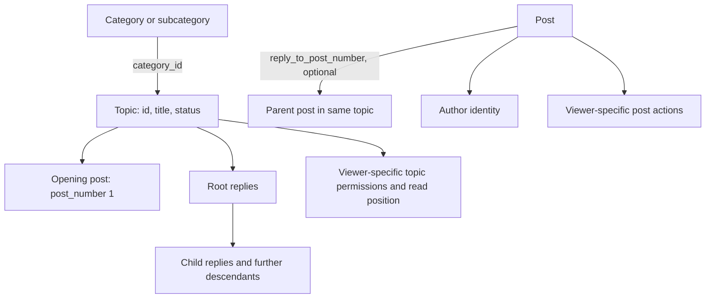
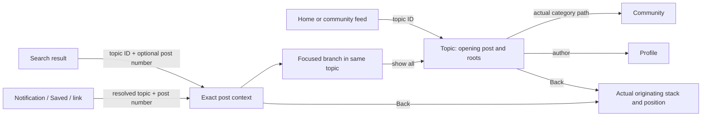
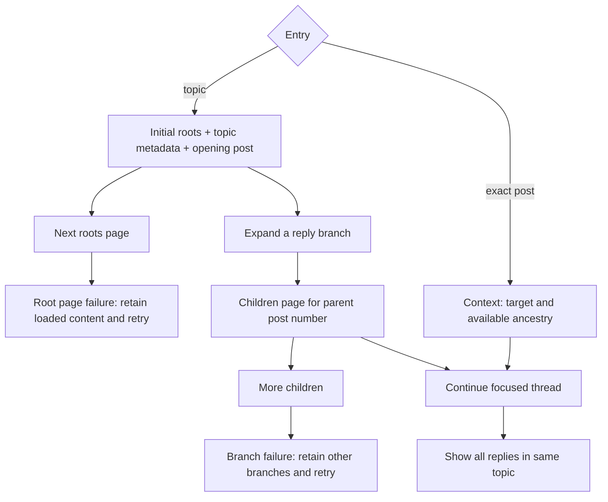
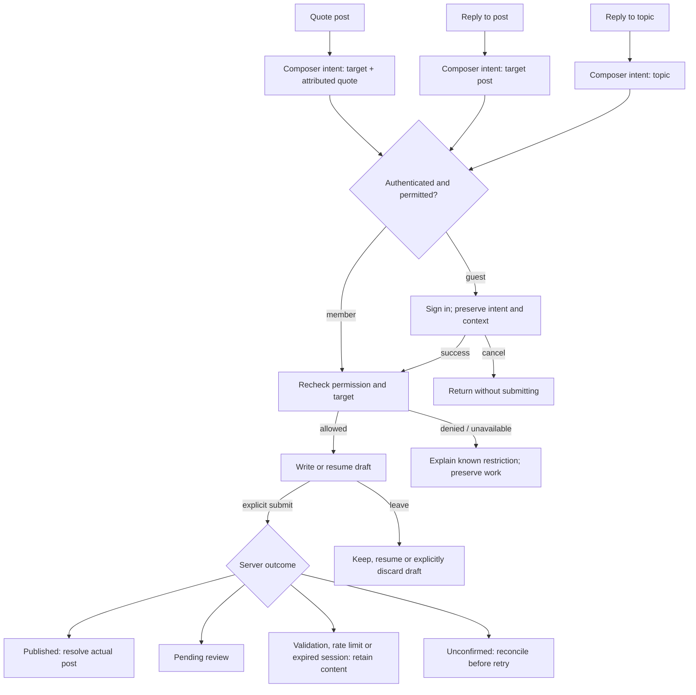

# Topic view: information architecture

Status: source-grounded working map, before visual design. 29 October 2026. Discourse reference HEAD: `d4296c5ecf2bef4f11e42d8f3fd2282c8752f4e2`. This is a refinement of [category and topic IA](category-topic-ia.md), not a new backend contract or a completed mockup. “Discussion” is the Fomio label for a Discourse topic. Source inspection is not proof of deployed settings, roles, or version alignment. Request specs were inspected, not run for this map.

## 1. Domain and identity



A category, topic, post ID and topic-local post number are different identities. A reply is a post in the same topic; a focused thread is a view into that topic, not a separate conversation. Quotes carry attribution and context; they do not themselves establish a parent relationship. Category ancestry and reply nesting are independent. Evidence: `db/structure.sql` (`topics`, `posts`, `categories`); `PostSerializer` (`topic_id`, `post_number`, `reply_to_post_number`, `actions_summary`); `TopicViewSerializer` (`id`, `category_id`, `closed`, `archived`).

## 2. Entry, destination and return



Back returns to the originating feed, search, notification or other context; the category path navigates to the topic's actual category. Preserve selected topic, reading anchor, expanded branches, list scope and originating position through navigation or resizing. These are native design requirements, not server guarantees. A missing or inaccessible exact target needs a truthful recovery state; do not treat every 404 as proof of deletion or disabled nesting.

## 3. Topic information hierarchy

1. Topic identity: title, actual category ancestry and relevant status.
2. Opening post: author, time, content and permitted post actions.
3. Replies: server-returned order and structure, with author, content, parent context and actions per post.
4. Continuation: further roots, branch children, focused context, loading and retry where applicable.
5. Topic-level participation: reply intent, draft and permission status. Its visual placement is undecided.

Optional metadata is shown only when present and meaningful. The reading experience must not imply unloaded replies are absent. Respect placeholders returned for deleted or ignored ancestors with visible descendants. Distinguish an empty discussion from a failed load and an inaccessible target.

## 4. Reading and branch navigation



The nested routes are conditional on the backend setting and authorization. Source `NestedTopicsController#show/#children/#context` and `config/routes.rb` expose roots, children and exact context; page zero includes topic metadata and the opening post. `context=0` requests a focused target without ancestors. `spec/requests/nested_topics_controller_spec.rb` covers visibility, pagination, context, ordering and placeholders. The requested sort and effective server sort must remain distinct. Deployed nested capability and role behavior require verification; do not silently substitute a flat view and claim equivalence.

## 5. Actions and composer intent



Topic reply, post reply and quote are separate intents. A draft retains its target and quote where supported by the native implementation; this is a product requirement, not a claim about arbitrary server drafts. Signing in never automatically posts. Like and Save are per-user mutations with failure recovery; Share is a link/export action. Edit, flag, notification settings and moderation are deferred unless explicitly scoped. Source: `PostsController#create`, `PostCreator`, `TopicViewDetailsSerializer#include_can_create_post?`, `PostSerializer`, and the existing [flows and recovery](flows-and-recovery.md).

## 6. Permissions and states

| Condition | Information architecture response | Evidence / qualification |
| --- | --- | --- |
| Guest | Read only what the site permits; retain an intended action through sign-in | `TopicViewDetailsSerializer#include_can_create_post?`; actual site access unknown |
| Reply allowed | Offer contextual reply actions, still subject to server validation | `TopicGuardian#can_create_post_on_topic?`; `PostsController#create` |
| Closed or archived | Show status; derive available actions from current viewer permission | Guardian has administrator, moderator and other privileged exceptions; status alone is not a universal denial |
| Slow mode / validation / rate limit | Explain the server response and retain writing | `TopicViewSerializer#slow_mode_seconds`; posting rules can change after preflight |
| Missing / inaccessible / unsupported | Show a non-speculative unavailable or capability state and a return path | Nested controller gates feature and visibility; a 404 does not identify the cause |
| Initial / root / branch failure | Retry the affected load; keep previously visible content when safe | Native recovery requirement; don't conflate failure with empty |
| Permission changes | Revalidate before writes; clear content that may no longer be visible | Native security requirement, not a new server endpoint |
| Pending / uncertain submission | Distinguish moderation from unconfirmed delivery; reconcile before retry | Existing [API reference](discourse-api-reference.md) and recovery flow |

## 7. Adaptive ownership, not layout

| Context | Navigation responsibility | Topic responsibility |
| --- | --- | --- |
| One pane, standard iPhone or narrow iPad | Return to the originating list or route; preserve its context | Topic content and contextual actions; no duplicate global destination navigation inside the reader |
| Two panes, wide iPad | List pane owns list scope and global navigation; topic selection remains identifiable | Reader owns topic and post actions; preserve independent reading position |
| Resized, large text, RTL | Reflow or collapse without changing identity, intent or return path | Preserve target, branch, draft and permission state; use system safe areas |

These are design proposals, not fixed breakpoints or verified SwiftUI behaviors. The placement, styling and persistence of a topic reply affordance are open design choices to prototype after this map is reviewed.

## 8. Trace and verification ledger

**Goal:** Read a permitted topic and its nested replies, navigate to an exact post, and begin an appropriately targeted reply.

**Entry point:** `GET /t/:id.json` → `TopicsController#show`; nested JSON `GET /n/:slug/:topic_id.json`, `/children/:post_number.json`, `/context/:post_number.json` → `NestedTopicsController#show/#children/#context`; `POST /posts.json` → `PostsController#create` (`config/routes.rb`).

**Client trigger:** Discourse web topic and nested reader; Fomio uses its own native API client. Exact web component ownership is not established in this focused pass.

**Server path:** `TopicsController#show` resolves `TopicView`; nested controller calls `NestedTopic::ListRoots`, `ListChildren`, and context services; creation delegates to `PostCreator`. See controllers and service files for parameter validation.

**Data map:** `topics.id/category_id/closed/archived`, `posts.id/topic_id/post_number/reply_to_post_number`, `categories.id/parent_category_id` in `db/structure.sql`; associations in `Topic` and `Post`.

**Permissions:** Topic visibility and nested feature gates; `TopicGuardian#can_create_post_on_topic?` and `PostGuardian` control writes. The server rechecks authorization and validation. Privileged closed-topic exceptions exist.

**Async and realtime:** Post-creation jobs and MessageBus effects are not exhaustively traced in this focused map; **unknown**. Do not assume delivery, timing or subscription semantics. Trace `PostCreator`, post jobs and publishers before implementation relies on them.

**Serializer:** `TopicViewSerializer` supplies topic identity/status/read metadata and details; `TopicViewDetailsSerializer#include_can_create_post?` conditionally includes permission; `PostSerializer` supplies post identity, parent number and action summary. Nested tree serialization is in `NestedReplies::TreeLoader` and `PostTreeSerializer`. Fields may be conditional.

**Tests:** Read `spec/requests/nested_topics_controller_spec.rb` for roots/children/context and access, and `spec/requests/posts_controller_spec.rb` for reply retrieval and creation. These were not executed in this pass.

**Safest extension path:** Native SwiftUI presentation needs no theme or backend change. For web-only presentation consider a theme component first; if a missing server capability is proven, assess a plugin before a core patch. No backend change is authorized by this task.

**Verification commands** (run against the reference checkout, not a production site):

```sh
cd '/Volumes/Develop/Projects/Dicourse'
git rev-parse HEAD
rg -n 'nested_topics#|topics#show|topics#posts' config/routes.rb
rg -n 'can_create_post_on_topic|include_can_create_post|reply_to_post_number' lib/guardian app/serializers
bundle exec rspec spec/requests/nested_topics_controller_spec.rb
```

Open decisions: which topic metadata and actions belong in launch scope; exact reply entry presentation; fallback when nested replies are unavailable; final terminology and accessibility order. Confirm deployment settings, per-user permissions, effective ordering and exact-post behavior before treating source evidence as live behavior.
